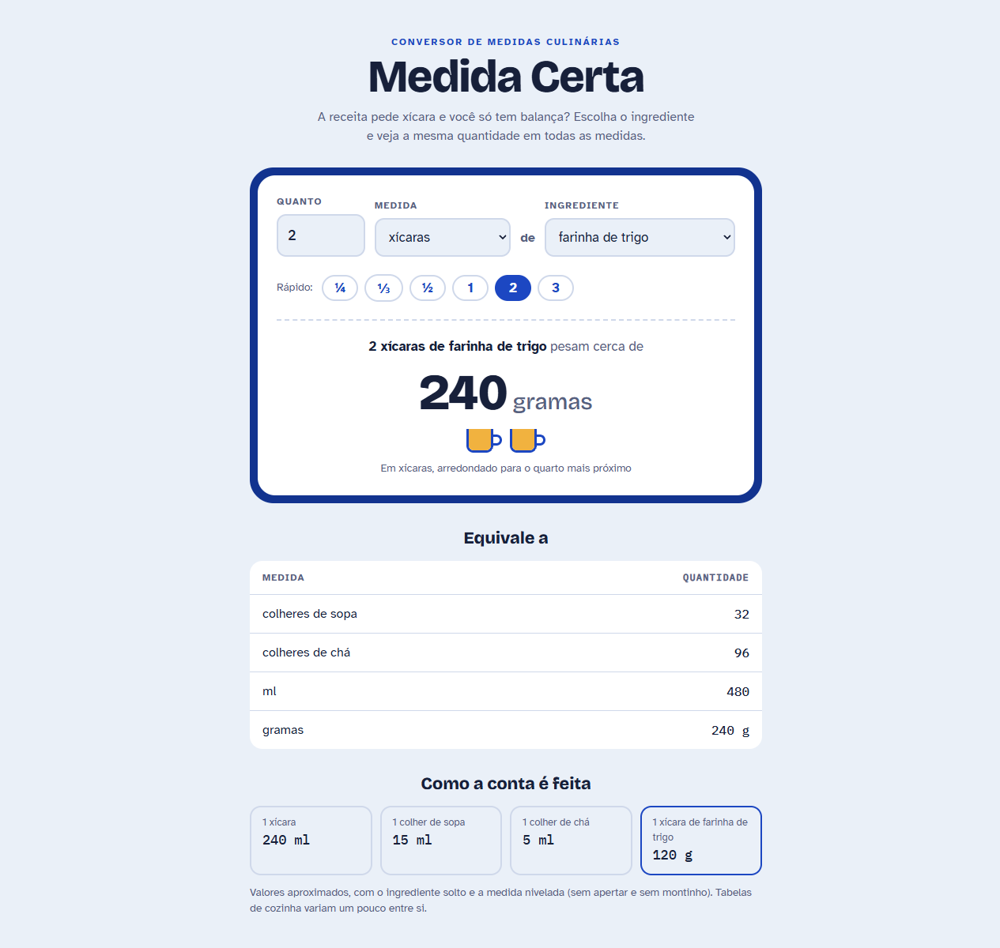

# Medida Certa · Conversor de medidas culinárias

Atividade individual da unidade **Frontend dinâmico com JavaScript** (M3U2).
Você vai fazer um conversor de medidas de cozinha: a pessoa escolhe o
ingrediente, diz quanto tem, e a página mostra o mesmo tanto em xícaras,
colheres, ml e gramas, **enquanto ela digita**.

O HTML, o CSS e os dados já vêm prontos. **O projeto inteiro é um arquivo
JavaScript.**



As outras referências estão em `referencias/`: a conversão a partir de gramas
(`02-de-gramas.png`), o aviso de erro (`03-erro.png`), a página no celular
(`04-celular.png`) e no modo escuro do sistema (`05-escuro.png`).

As referências mostram também os extras da **evolução do projeto** (as xícaras desenhadas
e as frações como "1 ½"). Sem eles, a página fica igual, só sem esses
detalhes.

---

## Antes de começar

1. Faça o fork deste repositório para a sua conta, clone o **seu** fork e só
   então comece a desenvolver. Se tiver dúvida, o passo a passo está no fim
   deste arquivo.
2. Abra a pasta no VS Code e rode a página com a extensão **Live Server**
   (botão *Go Live*, no canto de baixo).
3. Abra o console do navegador (F12 › Console), digite `UNIDADES` e aperte
   Enter. Depois, `INGREDIENTES`. Explore os objetos antes de escrever código.

Não precisa instalar nada além do VS Code e do Live Server.

## O briefing

O **Medida Certa** é um perfil de receitas de família. As receitas vêm em
xícaras e colheres, e todo dia alguém pergunta nos comentários: "quanto é
isso em gramas? eu só tenho balança!".

O pedido: "quero um link na bio que responda sozinho. A pessoa escolhe o
ingrediente, diz quanto tem, e vê o mesmo tanto em xícara, colher e gramas".

O texto completo está em `docs/01-briefing-do-cliente.md`.

## O que a página precisa fazer

1. **Selects** de medida e de ingrediente, preenchidos a partir dos dados.
2. **Conversão automática** a cada tecla, a cada troca de select e a cada
   clique nos atalhos (¼ ⅓ ½ 1 2 3).
3. **Resultado**: "**2 xícaras de farinha de trigo** pesam cerca de **240
   gramas**", com singular e plural certos. Partindo de gramas, a frase se
   inverte ("cabem em cerca de 2 xícaras").
4. **Tabela "Equivale a"** com todas as outras medidas.
5. **A conta do ingrediente** ("1 xícara de farinha de trigo = 120 g").
6. **Aviso de erro** para campo vazio, texto, zero ou número negativo. A
   vírgula (`0,5`) vale.

O comportamento de cada item, em detalhe, está em
`comportamento-interativo.md`. **Esse documento é a sua especificação**: leia
inteiro antes de escrever a primeira linha.

## O que você recebe

```
medida-certa/
├── css/
│   └── medida-certa.css ........... estilo pronto (não edite)
├── dados/
│   └── medidas.js ................. constantes UNIDADES e INGREDIENTES
├── docs/
│   ├── 01-briefing-do-cliente.md .. o pedido, as medidas e os ingredientes
│   ├── 02-dados-e-calculos.md ..... formato dos dados, a conta, valores esperados e pegadinhas
│   └── 03-componentes.md .......... os elementos da página e o HTML que o JS cria
├── referencias/
│   ├── 01-inicio.png .............. ao abrir
│   ├── 02-de-gramas.png ........... partindo de gramas
│   ├── 03-erro.png ................ quantidade inválida
│   ├── 04-celular.png ............. no celular
│   └── 05-escuro.png .............. com o sistema no modo escuro
├── index.html ..................... a página (pronta, sem os dados)
├── comportamento-interativo.md .... como a página deve reagir
└── README.md ...................... este arquivo
```

## O que você entrega

1. O arquivo que o `index.html` já chama:

   ```
   js/
   └── conversor.js .... preenche os selects, converte e monta o resultado e a tabela
   ```

   É um script comum, não um módulo. Ele é carregado depois de
   `dados/medidas.js`, então `UNIDADES` e `INGREDIENTES` já existem quando ele
   roda.

2. O site publicado no **GitHub Pages**, com o link na descrição do
   repositório.

## Regras

1. **JavaScript puro.** O projeto existe para você praticar o DOM. Uma
   biblioteca ou framework de interface (jQuery, React) faria esse trabalho
   por você, por isso deixe-os de fora daqui.
2. **Não edite o `index.html` nem o CSS.** Toda mudança na página vem do
   JavaScript.
3. **Os dados vêm de `UNIDADES` e `INGREDIENTES`.** Não copie as listas para
   dentro do seu script e não escreva no código os gramas de nenhum
   ingrediente nem os ml de nenhuma medida.
4. **Texto vai para a tela com `textContent`**, nunca com `innerHTML`.
5. **O JavaScript não escreve estilo.** Nada de `elemento.style`: você liga e
   desliga `hidden`, classes e atributos.
6. **Sem `alert()`, `confirm()` ou `prompt()`.** Toda mensagem aparece na
   própria página.
7. Você pode usar IA como tutora, com o prompt da unidade, para tirar dúvidas e
   revisar o seu código. Não peça para ela fazer o projeto: você precisa
   entender e saber explicar cada trecho do que entregar.

## O que você vai desenvolver

Ao concluir este projeto você terá praticado:

**DOM: introdução e manipulação de elementos**
- Selecionar elementos com `querySelector` e `querySelectorAll`
- Criar elementos com `createElement` (`option`, `tr`, `td`, `strong`) e
  adicionar na página com `append`
- Preencher texto com `textContent` e limpar com `replaceChildren`
- Mostrar e esconder com `hidden`, ligar e desligar classes e atributos

**DOM: eventos e formulários**
- `input` no campo, `change` nos selects e `click` nos atalhos
- Ler `value` e `dataset`
- Converter o texto do campo em número e tratar vírgula, vazio e `NaN`

**Arrays e funções de arrays (`map`, `filter`, `forEach`)**
- `find` para achar a medida e o ingrediente escolhidos
- `filter` para tirar a medida escolhida da tabela
- `forEach` (ou `map`) para criar as opções e as linhas

**Função anônima, callback e arrow functions**
- Passar uma função para o `addEventListener` e para os métodos de array
- Escrever essas funções com arrow function, quando ficar mais claro

**Desestruturação de objetos**
- Tirar do objeto só o que precisa: `const { nome, gramasPorXicara } = ingrediente`

**Formatação**
- Fazer a conta em duas etapas (medida → gramas → medida)
- Formatar com `Intl.NumberFormat`

---

## Roteiro sugerido

As etapas estão na ordem que facilita a construção do projeto, não na ordem
das aulas. Cada uma mostra os **assuntos** que pratica: se algum ainda não foi
visto em aula, use as fontes de consulta do fim deste arquivo. Faça um commit
ao fim de cada etapa.

### Etapa 1 · Ponto de partida e selects

*Assuntos: DOM: introdução e manipulação de elementos · forEach · callback*

Crie `js/conversor.js`. Selecione os elementos da tabela de
`docs/03-componentes.md` e guarde cada um em uma constante. Escreva
`criarOpcao(valor, texto)` e preencha os dois selects a partir de `UNIDADES` e
`INGREDIENTES`.

`querySelector` · `createElement` · `append` · `forEach`

### Etapa 2 · Ler a quantidade

*Assuntos: DOM: eventos e formulários*

Escreva uma função que lê o campo e devolve o número, ou `null` se não for
válido. Teste no console com `2`, `0,5`, `0.5`, vazio, `abc`, `0` e `-2`
antes de seguir. Leia a seção "Pegadinhas" de `docs/02-dados-e-calculos.md`.

`value` · `trim` · `replace` · `Number` · `Number.isNaN`

### Etapa 3 · A conta e o resultado

*Assuntos: Arrays · callback e arrow functions · Desestruturação · DOM: eventos*

Escreva duas funções: uma que leva qualquer medida para gramas e outra que
leva gramas para qualquer medida (a fórmula está em
`docs/02-dados-e-calculos.md`). Para achar a medida e o ingrediente
escolhidos, use `find` com uma arrow function, e desestruture o objeto
encontrado para pegar só os campos que a conta usa. Monte a frase e o número
em `#frase` e `#gramas`, com singular e plural. Escreva uma função
`atualizar()` que faz tudo isso e chame-a ao abrir a página, no `input` do
campo e no `change` dos selects.

`find` · `=>` · `const { ... } = objeto` · `Intl.NumberFormat` · `addEventListener` · `replaceChildren`

### Etapa 4 · A tabela e a conta

*Assuntos: filter e forEach · DOM: manipulação de elementos*

Dentro de `atualizar()`, limpe `#tabela-corpo` e crie uma `<tr>` para cada
medida, menos a escolhida. Preencha também a conta do ingrediente. Confira com
a tabela de valores esperados.

`filter` · `createElement('tr')` · `createElement('td')` · `classList`

### Etapa 5 · Atalhos, erro e acabamento

*Assuntos: DOM: eventos e formulários*

Faça os atalhos funcionarem e marcarem `aria-pressed`. Trate a quantidade
inválida (aviso, classe `com-erro`, `aria-invalid` e esconder resultado e
tabela). Trate o caso de partir de gramas. Faça todos os testes da seção 5 de
`docs/02-dados-e-calculos.md`, compare com as referências, passe pela lista de
entrega e publique no GitHub Pages.

`dataset` · `setAttribute` · `removeAttribute` · `hidden`

---

## Evolução do projeto (opcional)

Depois que tudo da lista de entrega estiver funcionando, você pode continuar o
projeto. Nada aqui é obrigatório.

- **Frações de cozinha**: na tabela, `1,5` vira `1 ½` e `6,67` vira `6 ⅔`
  (modelo em `docs/03-componentes.md`).
- **Xícaras desenhadas**: abaixo do número, uma xícara cheia para cada xícara
  inteira e uma parcial para o resto (modelo em `docs/03-componentes.md`).
- **Ingrediente lembrado**: o último ingrediente escolhido volta selecionado
  quando a pessoa reabre a página. Procure por `localStorage`.
- **Receita inteira**: um campo "Porções" que multiplica a quantidade.

## Lista de entrega

- [ ] Os dois selects são preenchidos a partir dos dados
- [ ] Ao abrir, a página já mostra 2 xícaras de farinha de trigo
- [ ] A conversão acontece ao digitar, ao trocar os selects e ao clicar nos atalhos
- [ ] Os valores batem com a tabela de `docs/02-dados-e-calculos.md`
- [ ] Singular e plural certos ("1 xícara ... pesa", "2 xícaras ... pesam")
- [ ] Partindo de gramas, a frase diz em quantas xícaras (ou colheres) cabe
- [ ] A tabela não mostra a medida escolhida
- [ ] `0,5` e `0.5` funcionam igual
- [ ] Campo vazio, texto, zero e negativo mostram o aviso e escondem o resultado
- [ ] O atalho certo fica marcado
- [ ] Nenhum `NaN`, `undefined` ou `null` aparece na tela
- [ ] Nenhuma lista copiada no código, nenhum `innerHTML` e nenhum `.style` no JS
- [ ] Nenhum erro vermelho no console
- [ ] O site está publicado no GitHub Pages

## Como fazer o fork

**1. Faça o fork.** No topo desta página, clique em **Fork** e, na tela
seguinte, em **Create fork**. O endereço passa a ter o seu usuário.

**2. Clone a SUA cópia.** Confira que o endereço tem o seu usuário, não o da
professora, e clone:

```
git clone https://github.com/SEU-USUARIO/medida-certa.git
cd medida-certa
```

**3. Trabalhe e envie.** Faça commits pequenos, um por etapa do roteiro:

```
git add .
git commit -m "etapa 3: conta e resultado"
git push
```

**4. Publique.** No seu repositório, abra *Settings › Pages*, escolha a branch
`main` e a pasta `/ (root)` e salve. Em um ou dois minutos, o link aparece no
topo da mesma tela. Coloque esse link na descrição do repositório (a
engrenagem ao lado de *About*). O passo a passo, com imagens, está na
[documentação do GitHub Pages](https://docs.github.com/pt/pages/getting-started-with-github-pages/creating-a-github-pages-site),
em português.

---

## Fontes de consulta

Em português, a não ser quando indicado.

- [GitHub: criar fork de um repositório](https://docs.github.com/pt/pull-requests/collaborating-with-pull-requests/working-with-forks/fork-a-repo)
- [MDN: Introdução ao DOM](https://developer.mozilla.org/pt-BR/docs/Web/API/Document_Object_Model/Introduction)
- [MDN: evento input](https://developer.mozilla.org/pt-BR/docs/Web/API/Element/input_event)
- [MDN: Array.prototype.find](https://developer.mozilla.org/pt-BR/docs/Web/JavaScript/Reference/Global_Objects/Array/find),
  [filter](https://developer.mozilla.org/pt-BR/docs/Web/JavaScript/Reference/Global_Objects/Array/filter) e
  [forEach](https://developer.mozilla.org/pt-BR/docs/Web/JavaScript/Reference/Global_Objects/Array/forEach)
- [MDN: Arrow functions](https://developer.mozilla.org/pt-BR/docs/Web/JavaScript/Reference/Functions/Arrow_functions)
- [MDN: Atribuição via desestruturação](https://developer.mozilla.org/pt-BR/docs/Web/JavaScript/Reference/Operators/Destructuring_assignment)
- [MDN: Number](https://developer.mozilla.org/pt-BR/docs/Web/JavaScript/Reference/Global_Objects/Number)
- [MDN: Intl.NumberFormat](https://developer.mozilla.org/pt-BR/docs/Web/JavaScript/Reference/Global_Objects/Intl/NumberFormat)
- [MDN: Element.replaceChildren](https://developer.mozilla.org/en-US/docs/Web/API/Element/replaceChildren) (em inglês)
- [MDN: usando atributos data-*](https://developer.mozilla.org/pt-BR/docs/Learn/HTML/Howto/Use_data_attributes) (o que o `dataset` lê)
