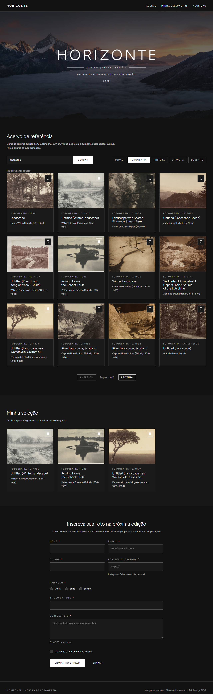

# Horizonte · Acervo

Projeto desafio individual da unidade **Frontend dinâmico com JavaScript**
(M3U2). Você vai transformar uma página estática em uma aplicação que busca
obras de arte em uma API pública, mostra os detalhes de cada uma, guarda as
favoritas no navegador e valida um formulário de inscrição.

O HTML e o CSS já vêm prontos. **O projeto inteiro é JavaScript.**



---

## Antes de começar

1. Faça o fork deste repositório para a sua conta, clone o **seu** fork e só
   então comece a desenvolver. Se tiver dúvida, o passo a passo está no fim
   deste arquivo.
2. Abra a pasta no VS Code e rode a página com a extensão **Live Server**
   (botão *Go Live*, no canto de baixo). Abrir o `index.html` com dois cliques
   não funciona neste projeto: módulos JavaScript (`type="module"`) e `fetch`
   precisam que a página venha de um servidor, mesmo que local.

## O briefing

A **Horizonte** é uma mostra de fotografia de paisagem que está na terceira
edição. Os três eixos da mostra são Litoral, Serra e Sertão. A curadoria passou
meses pesquisando o acervo aberto do Cleveland Museum of Art, que publica mais
de 30 mil obras em domínio público e oferece uma API gratuita, sem cadastro.

Agora a equipe quer abrir essa pesquisa para o público. O pedido veio da
curadora: "quero que as pessoas façam o mesmo caminho que a gente fez:
procurar, abrir a obra, olhar com calma e guardar as que tocaram. E, no fim,
que dê vontade de mandar a própria foto para a quarta edição".

A designer já entregou a página montada, com a identidade da mostra. Falta
fazer a página **funcionar**. Esse é o seu trabalho.

O texto completo do pedido, as mensagens aprovadas e a tradução dos tipos de
obra estão em `docs/01-briefing-do-cliente.md`.

## O que a página precisa fazer

1. **Menu** que abre e fecha no celular.
2. **Acervo** carregado da API, em cartões com foto, tipo, data, título e
   autoria. São 12 obras por página.
3. **Busca** por palavra e **filtro por tipo** (fotografia, pintura, gravura e
   desenho), que funcionam juntos.
4. **Paginação** com anterior, próxima e a indicação "Página X de Y".
5. **Estados da grade**: carregando, nenhum resultado e erro com opção de
   tentar de novo.
6. **Janela de detalhe**, que abre ao clicar em um cartão e busca na API as
   informações completas da obra.
7. **Minha seleção**: guardar e remover obras, com a escolha salva no navegador
   (ela continua lá depois de recarregar a página). A seleção ganha uma seção
   própria, e o menu mostra quantas obras foram guardadas.
8. **Formulário de inscrição** validado pelo seu código, com mensagens de erro
   em cada campo, contador de caracteres e envio simulado.

O comportamento de cada um desses itens, em detalhe, está em
`comportamento-interativo.md`. **Esse documento é a sua especificação**: leia
inteiro antes de escrever a primeira linha.

## O que você recebe

```
horizonte-acervo/
├── css/
│   ├── estilo-base.css ............ estilo pronto (não edite; veja "Regras")
│   └── README.md .................. guia das classes e variáveis do estilo
├── img/
│   └── horizonte.jpg .............. foto da capa
├── dados/
│   └── obras-exemplo.json ......... uma resposta real da API, para começar sem internet
├── docs/
│   ├── 01-briefing-do-cliente.md .. pedido, textos e mensagens aprovadas
│   ├── 02-guia-da-api.md .......... como usar a API do museu
│   └── 03-componentes.md .......... HTML dos pedaços que o seu JS vai criar
├── vitrine/
│   ├── index.html ................. todos os componentes do estilo, nos três temas
│   └── img/ ....................... imagens usadas só na vitrine
├── index.html ..................... página estática pronta
├── comportamento-interativo.md .... como a página deve reagir a cada ação
├── referencia-desktop.png ......... resultado esperado em tela larga
├── referencia-mobile.png .......... resultado esperado no celular
├── TUTOR-M3.md .................... prompt do tutor de IA do módulo (veja "Regras")
└── README.md ...................... este arquivo
```

O guia completo das classes do CSS (o que cada uma faz e como ligar e desligar
estados) está em `css/README.md`.

## O que você entrega

1. A pasta `js/` com o seu código, organizado em **módulos** (mais de um
   arquivo, com `import` e `export`). Sugestão de divisão:

   ```
   js/
   ├── main.js ......... ponto de partida: liga os eventos e chama as outras partes
   ├── api.js .......... as funções que conversam com a API
   ├── componentes.js .. funções que criam cartão, estados e detalhe
   ├── selecao.js ...... ler, salvar e alternar a seleção no localStorage
   └── formulario.js ... validação e envio da inscrição
   ```

   A divisão é sua. O que não pode é tudo em um arquivo só.

2. A página publicada no **GitHub Pages**, com o link na descrição do
   repositório.

## Regras

1. **JavaScript puro.** O projeto existe para você praticar o DOM e o consumo
   de API. Uma biblioteca de interface (jQuery, React) ou de requisição (axios)
   faria esse trabalho por você, por isso deixe-as de fora daqui.
2. **Não edite o `index.html`**, a não ser para ligar uma folha de tema sua.
   Toda mudança na página vem do JavaScript.
3. **Não edite o `estilo-base.css`.** Para mudar cores e fontes, crie
   `css/meu-tema.css` e sobrescreva as variáveis (veja `css/README.md`).
4. **Dado que vem da API vai para a tela com `textContent`** (ou `createElement`
   + `textContent`), nunca colado direto dentro de `innerHTML`. O motivo está no
   guia da API.
5. **O JavaScript não escreve estilo.** Nada de `elemento.style.alguma-coisa`:
   você liga e desliga classes, atributos (`aria-pressed`, `aria-invalid`,
   `aria-expanded`) e o `hidden`.
6. **Sem `alert()`, `confirm()` ou `prompt()`.** Toda mensagem aparece na
   própria página.
7. **Toda chamada à API trata os erros.** Na versão final, com `async`/`await`
   e `try`/`catch`, conferindo o `response.ok`. A Etapa 2 começa com `.then` e
   `.catch` de propósito, para você ver as duas formas.
8. Você pode usar IA como tutora, com o prompt do tutor do módulo
   (`TUTOR-M3.md`, nesta pasta), para tirar dúvidas e
   revisar o seu código. Não peça para ela fazer o projeto: você precisa
   entender e saber explicar cada trecho do que entregar.

## O que você vai desenvolver

Ao concluir este projeto você terá praticado:

**DOM: manipulação de elementos**
- Selecionar elementos e alterar texto, atributos e classes
- Criar elementos com `createElement`, montar e inserir na página
- Mostrar e esconder com `hidden`
- Funções-componente: recebem um objeto e devolvem um elemento pronto
- Uma função que redesenha a grade sempre que o estado (busca, tipo, página,
  seleção) muda

**DOM: eventos e formulários**
- `click`, `submit`, `input`, `blur`, `keydown`
- Delegação de eventos: um único ouvinte para todos os cartões da grade
- Ler os valores com `FormData` e validar com mensagem por campo e foco no
  primeiro erro
- Acessibilidade dos erros (`aria-invalid`, `aria-describedby`)

**Arrays, callbacks, arrow functions e desestruturação**
- `map`, `filter`, `some` e `find` sobre as obras e a seleção
- Desestruturar a resposta da API (`const { data, info } = resposta`) e o
  parâmetro de busca (`buscarObras({ busca, tipo, pagina })`)

**Como aplicar módulos**
- Dividir o código em arquivos com `import`, `export` e `type="module"`

**Promises e requisições assíncronas**
- O que é uma `Promise` e por que o `fetch` devolve uma
- Encadear com `.then()` e tratar com `.catch()`
- Criar uma `Promise` própria (o envio simulado do formulário)
- Reescrever com `async`/`await`

**Tratamento de erros**
- `try`/`catch`/`finally` em volta do `await`
- A diferença entre **erro de rede** (o `fetch` rejeita) e **erro HTTP**
  (o `fetch` resolve, mas `response.ok` é `false`): só o primeiro cai no
  `catch` sozinho
- `throw new Error(...)` para transformar um 404 em erro tratável
- Mensagem diferente para cada caso na tela, e "tentar de novo"

**O que é REST, API e JSON**
- Recursos e endereços de uma API REST (`/artworks` e `/artworks/{id}`)
- Parâmetros de consulta na URL (`URLSearchParams`), método `GET` e códigos
  de status (200, 404)
- Ler uma resposta JSON e a documentação de uma API real
- `JSON.stringify` e `JSON.parse` para guardar a seleção no `localStorage`

**Consumo de API JSON**
- Estados de carregando, vazio e erro na interface
- Lista vazia e campos que faltam tratados sem `undefined` na tela

---

## Roteiro sugerido

As etapas estão na ordem que facilita a construção do projeto, não na ordem
das aulas. Cada uma mostra os **assuntos** que pratica: se algum ainda não foi
visto em aula, use as fontes de consulta do fim deste arquivo. Você não
precisa terminar uma etapa perfeita para começar a próxima, mas não pule a
ordem. Faça um commit ao fim de cada etapa.

### Etapa 1 · Menu e esqueleto

*Assuntos: DOM: introdução e manipulação de elementos · DOM: eventos*

Crie `js/main.js` e faça o menu do celular abrir e fechar alternando o
`aria-expanded` do botão. Crie também uma função `mostrarAviso(texto, tipo)`
que preenche o `#toast`, mostra o aviso e o esconde de novo depois de 3
segundos. Ela vai ser usada o projeto inteiro.

`querySelector` · `addEventListener` · `setAttribute` · `hidden` · `setTimeout`

### Etapa 2 · A grade com dados de exemplo

*Assuntos: Promises · Arquivos JSON · DOM: manipulação de elementos · map / forEach*

Ainda sem a API: busque o arquivo `dados/obras-exemplo.json` com `fetch`. O
`fetch` não devolve os dados na hora: ele devolve uma **`Promise`**, uma
promessa de que a resposta vai chegar. Nesta etapa, use `.then()` e `.catch()`:

```js
fetch("dados/obras-exemplo.json")
  .then((resposta) => resposta.json())
  .then((dados) => {
    // aqui os dados já chegaram
  })
  .catch((erro) => {
    // aqui, se algo deu errado no caminho
  });
```

Cada `.then` recebe o resultado do anterior, e o `.catch` pega um erro que
aconteça em qualquer ponto da corrente. Coloque um `console.log` em cada
`.then` e outro depois do `fetch`: em que ordem eles aparecem? Por quê? Depois,
troque o nome do arquivo por um que não existe e veja o que acontece. Na Etapa
6 você reescreve tudo com `async`/`await`.

Pegue a lista de obras e desenhe os cartões na `#grade-obras`.

Escreva uma função `criarCardObra(obra)` que **recebe um objeto e devolve um
elemento** (o HTML de referência está em `docs/03-componentes.md`). Depois, uma
função `renderizarGrade(lista)` que limpa a grade e coloca um cartão para cada
obra. Preencha também o contador de resultados.

Atenção aos dados que faltam: há obras sem autoria e sem descrição no próprio
arquivo de exemplo. O seu cartão não pode mostrar `undefined`.

`fetch` · `.then` · `.catch` · `resposta.json()` · `createElement` · `textContent` · `forEach` ou `map` · `replaceChildren`

### Etapa 3 · A janela de detalhe

*Assuntos: DOM: eventos · callback e arrow functions · find*

Faça o clique no cartão abrir a janela com os dados daquela obra. Use
**delegação de eventos**: um único `addEventListener` na grade, que descobre
qual cartão foi clicado com `event.target.closest(...)` e um atributo
`data-id`.

A janela fecha pelo X, pela tecla Esc e pelo clique fora dela.

`closest` · `dataset` · `keydown` · `classList` · `find`

### Etapa 4 · O formulário de inscrição

*Assuntos: DOM: eventos e formulários · Promises*

Valide cada campo com as regras de `comportamento-interativo.md`. Escreva uma
função de validação **por campo**, que devolve a mensagem de erro ou uma string
vazia, e uma função que mostra ou limpa o erro na tela. No envio, valide tudo,
mostre o alerta e coloque o foco no primeiro campo com erro.

O envio é **simulado**: crie uma função `enviarInscricao(dados)` que devolve uma
`Promise` resolvida depois de 1,5 segundo. Enquanto ela não termina, o botão
fica no estado de carregando.

`submit` · `preventDefault` · `FormData` · `trim` · regex · `focus` · `new Promise`

### Etapa 5 · Minha seleção e módulos

*Assuntos: Como aplicar módulos · Arquivos JSON · Arrays*

Faça o botão de guardar funcionar. A seleção é uma lista de obras salva no
`localStorage` com a chave `horizonte:selecao`. Guarde só o que o cartão
precisa para ser desenhado de novo, não a resposta inteira da API.

Repare que o **mesmo** `criarCardObra` desenha os cartões das duas grades. Se
você precisou escrever outra função para a seleção, volte e reaproveite.

Com o projeto crescendo, é hora de **dividir o `main.js` em módulos**.

`localStorage` · `JSON.stringify` · `JSON.parse` · `some` · `filter` · `import` / `export`

### Etapa 6 · A API de verdade

*Assuntos: O que é REST · O que é uma API · Requisições HTTP · Promises e requisições assíncronas · Consumo de API JSON*

Troque o arquivo de exemplo pela API. Leia `docs/02-guia-da-api.md` com calma
antes de começar. Repare como uma API **REST** se organiza: cada tipo de dado
é um **recurso** com um endereço (`/artworks` para a lista, `/artworks/{id}`
para uma obra), o que você quer filtrar vai em **parâmetros de consulta** na
URL (`?q=sea&type=Photograph`), e a resposta vem com um **código de status**
(200 deu certo, 404 não encontrado) e o corpo em **JSON**.

- Uma função `buscarObras({ busca, tipo, pagina })` que monta a URL, faz o
  `fetch` e devolve os dados.
- Uma função `buscarObra(id)` para a janela de detalhe.
- Busca, filtro e paginação mudam o **estado** e chamam a mesma função de
  carregar.
- Os três estados da grade: carregando, vazio e erro.

Agora com **`async`/`await`**, que é outra forma de escrever o mesmo `.then`:
o `await` espera a `Promise` terminar e devolve o resultado, e o código fica
na ordem em que é lido. Reescreva também a busca da Etapa 2 assim e compare.

**Tratamento de erros.** Existem dois tipos de problema, e eles chegam de
jeitos diferentes:

| O que aconteceu | O que o `fetch` faz | Como você descobre |
| --- | --- | --- |
| Sem internet, endereço errado, servidor fora do ar | **rejeita** a `Promise` | cai no `catch` sozinho |
| A API respondeu, mas com erro (404, 500) | **resolve** normalmente | `response.ok` é `false`: você precisa conferir e lançar o erro com `throw new Error(...)` |

Use `try`/`catch`/`finally`: o `try` tem o caminho feliz, o `catch` mostra a
mensagem de erro (diferente para obra não encontrada e para falha de rede) e o
`finally` tira o carregando, dê certo ou dê errado. Teste os dois casos:
desligue a internet (DevTools › Network › Offline) e abra a janela de uma obra
com um `id` que não existe.

`async` / `await` · `try` / `catch` / `finally` · `throw new Error` · `response.ok` · `URLSearchParams` · `Math.ceil`

### Etapa 7 · Componentes e acabamento

*Assuntos: Como aplicar módulos · revisão de todos*

Revise o código com olhar de componente. Cada pedaço de interface (cartão,
estado, detalhe) deve ser uma função que recebe dados e devolve um elemento,
sem buscar nada na página por conta própria.

Em seguida, passe pela lista de entrega abaixo e publique no GitHub Pages.

---

## Evolução do projeto (opcional)

Depois que tudo da lista de entrega estiver funcionando, você pode continuar o
projeto. Nada aqui é obrigatório.

- **Busca enquanto digita**, esperando 400ms depois da última tecla (procure
  por *debounce*).
- **Estado na URL**: busca, tipo e página aparecem no endereço
  (`?q=sea&tipo=Photograph&pagina=2`), e recarregar a página mantém tudo.
  Procure por `URLSearchParams` e `history.replaceState`.
- **Resposta atrasada**: se a pessoa clicar em "Próxima" três vezes rápido, só a
  última resposta pode aparecer na tela. Procure por `AbortController`.
- **Foco na janela**: ao abrir, o foco vai para o botão de fechar; ao fechar,
  volta para o cartão que abriu a janela.
- **Ordenar a seleção** por data de criação da obra ou por data em que foi
  guardada.

## Lista de entrega

- [ ] O acervo carrega da API ao abrir a página
- [ ] Busca, filtro e paginação funcionam juntos e voltam para a página 1 quando devem
- [ ] Carregando, vazio e erro aparecem nos momentos certos, e "tentar de novo" funciona
- [ ] Sem internet e com obra inexistente, a mensagem certa aparece (erro de rede e 404 são tratados de forma diferente)
- [ ] As chamadas à API usam `async`/`await` com `try`/`catch`/`finally` e conferem o `response.ok`
- [ ] Nenhum `undefined` ou `null` aparece na tela, nem em obra sem autoria ou sem descrição
- [ ] A janela de detalhe abre, carrega da API e fecha pelo X, pelo Esc e pelo clique fora
- [ ] Guardar e remover funcionam no cartão e na janela, e os dois ficam sincronizados
- [ ] A seleção continua lá depois de recarregar a página, e o contador do menu acompanha
- [ ] Todas as regras do formulário funcionam, com a mensagem certa em cada campo
- [ ] O envio mostra o carregando, avisa que deu certo e limpa o formulário
- [ ] O menu abre e fecha no celular
- [ ] O código está em módulos, sem `innerHTML` com dado da API e sem `.style` no JS
- [ ] Nenhum erro vermelho no console
- [ ] A página está publicada no GitHub Pages

## Como fazer o fork

**1. Faça o fork.** No topo desta página, clique em **Fork** e, na tela
seguinte, em **Create fork**. O endereço passa a ter o seu usuário.

**2. Clone a SUA cópia.** Confira que o endereço tem o seu usuário, não o da
professora, e clone:

```
git clone https://github.com/SEU-USUARIO/horizonte-acervo.git
cd horizonte-acervo
```

**3. Trabalhe e envie.** Faça commits pequenos, um por etapa do roteiro:

```
git add .
git commit -m "etapa 2: grade com dados de exemplo"
git push
```

**4. Publique.** No seu repositório, abra *Settings › Pages*, escolha a branch
`main` e a pasta `/ (root)` e salve. Em um ou dois minutos, o link aparece no
topo da mesma tela. Coloque esse link na descrição do repositório (a
engrenagem ao lado de *About*). O passo a passo, com imagens, está na
[documentação do GitHub Pages](https://docs.github.com/pt/pages/getting-started-with-github-pages/creating-a-github-pages-site),
em português.

---

## Fontes de consulta

Em português, a não ser quando indicado.

- [GitHub: criar fork de um repositório](https://docs.github.com/pt/pull-requests/collaborating-with-pull-requests/working-with-forks/fork-a-repo)
- [MDN: manipulando documentos](https://developer.mozilla.org/pt-BR/docs/Learn/JavaScript/Client-side_web_APIs/Manipulating_documents)
- [MDN: Módulos JavaScript](https://developer.mozilla.org/pt-BR/docs/Web/JavaScript/Guide/Modules)
- [MDN: Usando promises](https://developer.mozilla.org/pt-BR/docs/Web/JavaScript/Guide/Using_promises)
- [MDN: Funções assíncronas (`async`/`await`)](https://developer.mozilla.org/pt-BR/docs/Web/JavaScript/Reference/Statements/async_function)
- [MDN: try...catch](https://developer.mozilla.org/pt-BR/docs/Web/JavaScript/Reference/Statements/try...catch)
- [MDN: usando Fetch](https://developer.mozilla.org/pt-BR/docs/Web/API/Fetch_API/Using_Fetch)
- [MDN: códigos de status HTTP](https://developer.mozilla.org/pt-BR/docs/Web/HTTP/Status)
- [MDN: JSON](https://developer.mozilla.org/pt-BR/docs/Web/JavaScript/Reference/Global_Objects/JSON)
- [MDN: Atribuição via desestruturação](https://developer.mozilla.org/pt-BR/docs/Web/JavaScript/Reference/Operators/Destructuring_assignment)
- [MDN: localStorage](https://developer.mozilla.org/pt-BR/docs/Web/API/Window/localStorage)
- [Documentação da API do museu](https://openaccess-api.clevelandart.org/) (em inglês)
