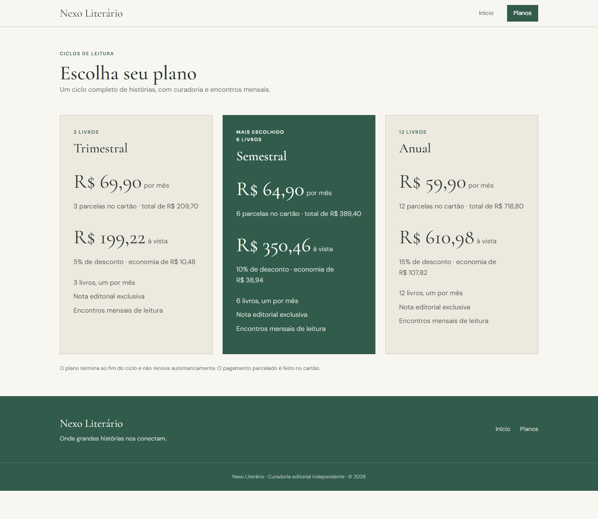

# Nexo Literário

Projeto individual da unidade **Frontend dinâmico com JavaScript** (M3-U2).
O foco desta unidade são duas telas: a Home, com livros carregados da API, e
a página de Planos, também montada a partir dos dados da API.

Resultado esperado: [Home](referencias/m3-u2-inicio.png) e
[Planos](referencias/m3-u2-planos.png).



## Objetivo

O Nexo Literário é um clube de leitura por assinatura. A programação de livros
e as opções de planos mudam sem que seja necessário alterar o HTML. Você vai
buscar esses dados com `fetch` em uma API criada com JSON Server e montar as
interfaces com JavaScript.

Na M3-U2, o trabalho termina nestas duas páginas:

- **Home (`index.html`)**: buscar `GET /livros` e renderizar os livros em uma
grade, com capa, título, autoria, mês, categoria e sinopse.
- **Planos (`planos.html`)**: buscar `GET /planos` e renderizar nome, duração,
benefícios, valor parcelado, desconto e valor à vista.

Não haverá página individual de livro, navegação por parâmetros da URL,
histórico de leituras, formulário de assinatura ou confirmação de compra. Esses
fluxos serão retomados na M3-U3, usando React.

## Preparação

1. Faça o fork do repositório, clone o seu fork e abra a pasta no VS Code.
2. No terminal, entre na pasta `api` e inicie o JSON Server (o `npx` baixa o
   pacote na primeira execução):

   ```sh
   cd api
   npx json-server@0.17.4 db.json
   ```

   A API ficará disponível em `http://localhost:3000`. Mantenha esse terminal
aberto enquanto desenvolve.
3. Abra o projeto com o Live Server. A página deve ser servida por HTTP para
que o navegador permita as chamadas `fetch` à API.

Os dados de exemplo estão em `api/db.json`. Consulte
[`docs/04-guia-da-api.md`](docs/04-guia-da-api.md) para entender as rotas e
testar a resposta antes de programar.

## O que desenvolver

Crie os arquivos JavaScript chamados pelas páginas. O HTML e o CSS já trazem
os recipientes e as classes visuais.

| Arquivo | Responsabilidade |
| --- | --- |
| `js/comum.js` | Menu para celular e funções auxiliares compartilhadas, se necessárias |
| `js/inicio.js` | Buscar livros na API e renderizar os cartões da Home |
| `js/planos.js` | Buscar planos na API, calcular valores e renderizar a página de Planos |

### Requisitos da Home

- Buscar a coleção completa em `GET /livros`.
- Exibir estado de carregamento, estado de erro com ação para tentar novamente
e estado vazio quando a API não devolver livros.
- Ordenar os livros pelo mês e montar um cartão para cada item recebido.
- Tratar campos opcionais, como capa ou sinopse ausentes, sem mostrar
`undefined`, `null` ou elementos quebrados.

### Requisitos de Planos

- Buscar a coleção completa em `GET /planos`.
- Exibir carregamento, erro com ação para tentar novamente e estado vazio.
- Criar um cartão para cada plano, mostrando os valores à vista e parcelado,
benefícios e indicação de destaque quando informada pela API.
- Calcular os valores a partir dos campos recebidos; não duplicar os preços no
HTML nem em outra lista local.

O detalhamento dos estados e dos campos está em
[`comportamento-interativo.md`](comportamento-interativo.md),
[`docs/02-dados-e-calculos.md`](docs/02-dados-e-calculos.md) e
[`docs/03-componentes.md`](docs/03-componentes.md).

## Conteúdos praticados

- Seleção de elementos e criação de nós com `createElement`.
- Renderização de listas com `forEach`, `map`, `filter` e `sort`.
- Eventos de `click` para tentar novamente e `change` quando necessário.
- Consumo de API com `fetch`, `async`/`await`, `try`/`catch` e `response.ok`.
- Estados de carregamento, erro, vazio e sucesso.
- Formatação de meses e valores monetários com APIs do JavaScript.
- Exibição segura de dados com `textContent`.

## Regras

1. Use JavaScript puro, sem bibliotecas ou frameworks.
2. Não altere o HTML e o `css/style.css`; implemente nos arquivos JavaScript
previstos.
3. Não use `innerHTML` para inserir dados recebidos da API. Crie elementos e
preencha dados com `textContent` e atributos apropriados.
4. Não escreva estilos pelo JavaScript. Use as classes existentes e o atributo
`hidden` para alternar estados.
5. Não mantenha cópias locais dos livros ou dos planos no código: a API é a
fonte dos dados da tela.
6. Trate erros HTTP e de rede. O `fetch` não rejeita automaticamente em uma
resposta 404 ou 500; confira `response.ok`.
7. Não use `alert()`, `confirm()` ou `prompt()`.

## Fora do escopo da M3-U2

Os arquivos abaixo continuam no repositório como referência para a M3-U3. Eles
não fazem parte desta entrega nem da avaliação e não aparecem na navegação.
Não precisa abri-los nem adaptá-los:

| Arquivo | Conteúdo legado |
| --- | --- |
| `clube.html` | Histórico de leituras e tabela de preços com abas |
| `assinar.html` | Formulário de assinatura e pagamento |
| `livro.html` e `livro-*.html` | Ficha individual de cada livro |
| `js/livros.js` | Cópia local dos livros; não use como fonte de dados |
| `referencias/01-*.png` a `06-*.png` | Capturas da versão anterior do site |

Não implemente leitura de parâmetros da URL nem navegação entre fichas de
livros. Esses comportamentos serão desenvolvidos em React na M3-U3. As páginas
legadas também carregam `js/comum.js` e `js/planos.js`, mas não precisam
funcionar com os seus scripts.

## Entrega

- [ ] A Home carrega e ordena os livros retornados por `GET /livros`.
- [ ] Cada livro aparece em um cartão criado pelo JavaScript.
- [ ] Planos carrega e apresenta os dados retornados por `GET /planos`.
- [ ] Valores, descontos e benefícios são derivados dos dados da API.
- [ ] As duas telas mostram carregamento, erro recuperável e lista vazia.
- [ ] Nenhum dado ausente aparece como `undefined` ou `null`.
- [ ] A interface funciona em tela larga e celular.
- [ ] Nenhum erro inesperado aparece no console.

## Critérios de avaliação

| Critério | Peso |
| --- | --- |
| Consumo correto das rotas da API | 25% |
| Renderização das listas de livros e planos | 30% |
| Estados de carregamento, erro e lista vazia | 20% |
| Tratamento e formatação dos dados | 15% |
| Organização, acessibilidade e responsividade | 10% |

## Como fazer o fork

1. No topo do repositório, clique em **Fork** e depois em **Create fork**.
2. Clone o seu fork, conferindo que o endereço contém o seu usuário:

   ```sh
   git clone https://github.com/SEU-USUARIO/nexo-literario.git
   ```

3. Abra a pasta clonada no VS Code e comece pela consulta direta às rotas da
API no navegador.
