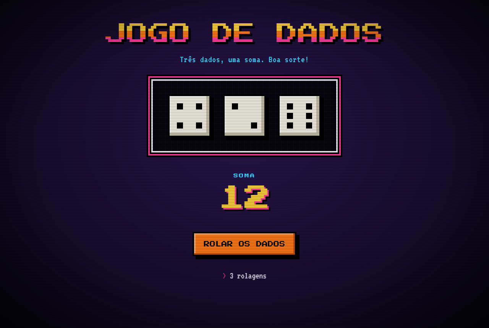

# Jogo de Dados · Seu primeiro projeto em React

Atividade individual da unidade **ReactJS** (M3U3), para quem está começando
no React. Você vai construir um jogo bem simples: **três dados na tela e a
soma deles**. A cada clique no botão, os três dados são rolados de novo e a
soma muda.

O jogo é pequeno de propósito. O objetivo não é o jogo: é entender as três
ideias que sustentam **todo** projeto React:

1. **Componentes**: dividir a tela em peças (`Dado`, `Soma`, `BotaoRolar`...).
2. **Props**: passar dados de uma peça para outra (`<Dado valor={4} />`).
3. **Estado com `useState`**: guardar o que muda e deixar o React redesenhar
   a tela sozinho.

O CSS vem pronto. **O projeto inteiro é React.**



As outras referências estão em `referencias/`: o jogo ao abrir
(`01-inicio.png`), no celular (`03-celular.png`) e com o desafio extra da
trinca (`04-desafio-trinca.png`).

---

## Antes de começar

1. Faça o fork, clone o **seu** fork e abra a pasta no VS Code. Se tiver
   dúvida, o passo a passo está no fim deste arquivo.
2. Confira se tem o Node instalado: `node -v` no terminal precisa mostrar a
   versão 20 ou maior.
3. **Leia `docs/01-entendendo-o-react.md` inteiro.** Ele explica, com
   exemplos, tudo o que este projeto usa: o que é um componente, como as props
   funcionam, o que o `useState` faz e como sortear um número com
   `Math.random`.

## O briefing

Um grupo de amigos se encontra toda semana para jogar um jogo de tabuleiro que
usa três dados, e sempre some um dado. Quem organiza as partidas pediu:
"quero abrir no celular, apertar um botão e ver os três dados e a soma, sem
fazer conta de cabeça. E quero saber quantas vezes a gente já rolou".

Não tem designer nem cliente exigente: o visual já está pronto no CSS e nas
referências. O seu trabalho é dar vida à tela com React.

## O que o jogo precisa fazer

1. **Título** "Jogo de Dados" e o subtítulo "Três dados, uma soma. Boa sorte!".
2. **Três dados**, cada um mostrando uma face de 1 a 6 com os pontinhos.
3. **A soma** dos três dados, em destaque.
4. **O botão "Rolar os dados"**: a cada clique, cada dado sorteia uma face
   nova, de 1 a 6, e a soma muda junto.
5. **O contador de rolagens**: "Nenhuma rolagem ainda", "1 rolagem",
   "2 rolagens"...

O comportamento em detalhe está em `comportamento-interativo.md`.

## O que você recebe

```
jogo-de-dados/
├── recursos/
│   └── estilo.css ................. estilo pronto (vai para src/)
├── docs/
│   ├── 01-entendendo-o-react.md ... componentes, props, useState e Math.random, com exemplos
│   └── 02-componentes.md .......... os componentes do jogo e a marcação de cada um
├── referencias/
│   ├── 01-inicio.png .............. ao abrir
│   ├── 02-depois-de-rolar.png ..... depois de algumas rolagens
│   ├── 03-celular.png ............. no celular
│   └── 04-desafio-trinca.png ...... com o desafio extra da trinca
├── comportamento-interativo.md .... como o jogo deve reagir
└── README.md ...................... este arquivo
```

## O que você entrega

O projeto React funcionando, criado com Vite, no seu repositório, com os
componentes em arquivos separados dentro de `src/components/`:

```
src/
├── main.jsx ............. monta o React e importa o CSS (o Vite já cria)
├── estilo.css
├── App.jsx .............. guarda o estado e monta a tela
└── components/
    ├── Dado.jsx
    ├── Soma.jsx
    ├── BotaoRolar.jsx
    └── Rolagens.jsx
```

## Regras

1. **React com Vite**, sem TypeScript.
2. **Bibliotecas:** o projeto foi pensado para funcionar só com `react` e
   `react-dom`, e tudo o que ele pede dá para fazer sem instalar mais nada. Se
   quiser usar outra biblioteca, pode, desde que ela não faça por você o que o
   projeto quer exercitar (componentes, props e estado) e que você anote no
   README qual instalou e por quê. Nem toda biblioteca é vista em aula: se
   escolher uma, a documentação dela é o seu material de estudo.
3. **Só um hook: `useState`.** O sorteio usa só `Math.random`.
4. **Um componente por arquivo**, em `src/components/`. O `App` junta as peças.
5. **O estado mora no `App`.** Os outros componentes recebem tudo o que
   precisam **por props**.
6. **A soma não é um estado.** Ela é calculada a partir dos valores dos dados
   (o `docs/01` explica por quê).
7. **Nunca altere o estado direto.** Nada de `valores[0] = 5`: crie uma lista
   nova e entregue para o `set`.
8. **Não edite o `estilo.css`** e **não use `style={{ }}`**. Use as classes de
   `docs/02-componentes.md`.
9. **Nenhuma manipulação direta do DOM** (`document.querySelector`,
   `innerHTML`, `addEventListener`). No React, a tela é consequência do estado.
10. Você pode usar IA como tutora, com o prompt da unidade, para tirar dúvidas
    e revisar o seu código. Não peça para ela fazer o projeto: você precisa
    entender e saber explicar cada trecho do que entregar.

## O que você vai desenvolver

Ao concluir este projeto você terá praticado:

**Apresentação do React: bibliotecas e frameworks**
- O que muda do JavaScript puro para o React, e por que o React é uma
  biblioteca e não um framework (`docs/01-entendendo-o-react.md`, seção 1)

**Projeto inicial com JSX e Vite**
- Criar um projeto React com o Vite e rodar em modo de desenvolvimento
- JSX: `className` no lugar de `class` e expressões dentro de `{ }`

**Componentes funcionais, componentização e reutilização**
- Criar um componente (uma função que devolve JSX) e usá-lo como uma tag
- Separar componentes em arquivos com `export default` e `import`
- Usar o mesmo componente (`Dado`) três vezes, com props diferentes

**Props**
- Passar um número (`valor`), um booleano (`jaRolou`) e uma **função**
  (`aoRolar`) de um componente para outro

**Hooks: `useState`**
- Guardar uma lista (os três valores) e um número (as rolagens)
- Trocar o estado com a função `set`, sempre com um valor novo
- Calcular valores a partir do estado em vez de criar estados repetidos

**Eventos**
- `onClick` no botão, chamando a função que chegou por props

**JavaScript que você já conhece, agora no JSX**
- Desenhar os pontinhos do dado com `Array.from` e `map`, com `key`
- Mostrar uma coisa ou outra com o ternário (a dica ou a soma)
- `Math.random` e `Math.floor` para sortear uma face de 1 a 6

**Build e deploy**
- Gerar a versão de produção e publicar o jogo na internet

---

## Roteiro sugerido

As etapas estão na ordem que facilita a construção do projeto, não na ordem
das aulas. Cada uma mostra os **assuntos** que pratica: se algum ainda não foi
visto em aula, use as fontes de consulta do fim deste arquivo. Faça um commit
ao fim de cada etapa.

### Etapa 0 · Montar o projeto

*Assuntos: Apresentação do React · Bibliotecas e frameworks · Criar um projeto inicial com arquivo JSX · Utilização do Vite*

Na pasta do repositório, crie o projeto React **dentro da própria pasta** (o
ponto no fim do comando é isso). Quando o Vite avisar que a pasta não está
vazia, escolha **"Ignore files and continue"**. Se ele fizer outras perguntas
(usar outra ferramenta de build, instalar e iniciar agora), responda **No**.

```
npm create vite@latest . -- --template react
npm install
npm run dev
```

Abra o endereço que aparecer no terminal (`http://localhost:5173`). A página
de boas-vindas do Vite deve aparecer. Depois:

1. Mova `recursos/estilo.css` para `src/`.
2. No `main.jsx`, troque `import './index.css'` por `import './estilo.css'`.
3. Apague `src/index.css`, `src/App.css` e a pasta `src/assets/`.
4. Apague todo o conteúdo do `App.jsx` e escreva só isto:

   ```jsx
   export default function App() {
     return <h1>Jogo de Dados</h1>;
   }
   ```

5. No `index.html` da raiz, troque `<html lang="en">` por `<html lang="pt-BR">`
   e mude o `<title>` para `Jogo de Dados`.

A tela deve mostrar só o título, em letras de pixel coloridas sobre um fundo
roxo-escuro de TV antiga. Se aparecer, o CSS está ligado. As fontes de pixel
vêm da internet: sem conexão, o jogo funciona igual, só com outra letra.

### Etapa 1 · O primeiro componente: `Dado`

*Assuntos: Componentes funcionais · Props*

Crie `src/components/Dado.jsx`. Por enquanto, ele desenha **sempre** o 4:
a marcação está em `docs/02-componentes.md`. Use o `Dado` três vezes dentro do
`App`.

Agora faça o `Dado` receber a prop `valor` e desenhar a face certa: a classe
`dado--{valor}`, o `aria-label` e **um pontinho para cada número do valor**.
No `App`, troque para `<Dado valor={4} />`, `<Dado valor={2} />` e
`<Dado valor={6} />`. Os três dados da referência devem aparecer.

Teste os seis valores, um de cada vez.

`function` · `export default` · `import` · props · `className` com template string · `Array.from` + `map` + `key`

### Etapa 2 · As outras peças

*Assuntos: Componentização e reutilização · Props · Eventos*

Crie `Soma`, `BotaoRolar` e `Rolagens`, e monte a tela inteira do `App` com
valores **fixos**:

- `<Soma total={12} jaRolou={true} />` mostra "Soma" e o 12. Com
  `jaRolou={false}`, mostra a dica "Clique no botão para rolar os dados.".
- `<Rolagens quantidade={3} />` mostra "3 rolagens". Teste com 0, 1 e 2.
- `<BotaoRolar aoRolar={...} />` é o botão. Por enquanto, passe uma função que
  só faz `console.log("rolou")` e confira no console.

`props` · ternário · props de função · `onClick`

### Etapa 3 · Estado e sorteio

*Assuntos: Hooks: useState · Eventos*

Agora a tela ganha vida. No `App`:

1. Crie o estado dos dados com `useState`, começando em `[1, 1, 1]`, e o
   estado das rolagens, começando em `0`.
2. Escreva `sortearFace()`, que devolve um número inteiro de 1 a 6
   (`docs/01-entendendo-o-react.md`, seção 5).
3. Escreva `rolarDados()`: ela cria uma **lista nova** com três sorteios,
   entrega para o `set` dos dados e soma 1 nas rolagens.
4. Passe `rolarDados` para o `BotaoRolar` pela prop `aoRolar`.
5. Troque os valores fixos pelos do estado: cada `Dado` recebe o seu valor, a
   `Soma` recebe o total **calculado** e `jaRolou`, e `Rolagens` recebe a
   quantidade.

Clique várias vezes. Os dados mudam, a soma acompanha e o contador sobe.

`useState` · `Math.random` · `Math.floor` · `set` com valor novo · estado derivado

### Etapa 4 · Conferir e publicar

*Assuntos: Build · Deploy*

Faça os testes da lista de entrega, compare com as referências (em tela larga
e no celular, pelo DevTools) e confira o console: nenhum aviso vermelho, nem o
de `key`. Depois, siga a seção [Publicação](#publicação).

---

## Evolução do projeto (opcional)

Depois que tudo da lista de entrega estiver funcionando, você pode continuar o
projeto. Nada aqui é obrigatório.

- **Trinca!** Quando os três dados mostrarem a mesma face, aparece a etiqueta
  "Trinca!" abaixo da soma (`referencias/04-desafio-trinca.png`). A classe
  `.trinca` já está no CSS: `<p className="trinca">Trinca!</p>`.
- **Os dados caem a cada rolagem.** O CSS já tem uma animação: o dado "cai" no
  painel quando aparece. Só que ela roda uma vez, quando o elemento é
  **criado**, e nas rolagens seguintes o React só troca a classe do dado que
  já existe. Para o React criar o dado de novo a cada rolagem, dê a cada
  `Dado` uma `key` que **muda** quando as rolagens mudam (a `key` é a
  "identidade" do elemento: identidade nova, elemento novo). Faça o mesmo com
  o número da soma.
- **Maior soma**: guarde a maior soma já tirada e mostre "Recorde: 16". É um
  terceiro estado, ou dá para calcular? Pense antes de escrever.
- **Quantos dados?** Botões "−" e "+" para jogar com 1 a 5 dados. A lista de
  valores muda de tamanho, e o `App` desenha os dados com `map`.
- **Recomeçar**: um botão que volta tudo ao início (dados em 1 e nenhuma
  rolagem).
- **Um visual só seu** (*Estilização de componentes*): crie um tema próprio
  para o jogo sem mexer no `estilo.css`. Comece pelo `Dado`: crie
  `Dado.module.css`, importe com `import estilos from "./Dado.module.css"` e use
  `className={estilos.dado}`. Abra o DevTools e veja o nome que a classe ganhou:
  por que ele não bate com outro `.dado` do projeto?
- **Confete na trinca** (*Utilização de bibliotecas*): instale a biblioteca
  `canvas-confetti` e chame `confetti()` quando sair uma trinca. Leia o README
  dela no npm para descobrir as opções de cor e quantidade.

## Lista de entrega

- [ ] Ao abrir, os três dados mostram 1 e aparece a dica no lugar da soma
- [ ] O contador começa em "Nenhuma rolagem ainda"
- [ ] Cada clique sorteia os três dados de novo, só com faces de 1 a 6
- [ ] A soma está sempre certa e aparece a partir da primeira rolagem
- [ ] "1 rolagem" no singular e "2 rolagens" no plural
- [ ] Cada dado desenha a face certa (teste os seis valores)
- [ ] Cada dado tem `aria-label` com o valor ("Dado mostrando 4")
- [ ] `Dado`, `Soma`, `BotaoRolar` e `Rolagens` em arquivos separados
- [ ] O estado fica só no `App`; a soma não é um estado
- [ ] Nenhum `style={{ }}`, `document.querySelector` ou `innerHTML`
- [ ] Nenhum erro nem aviso vermelho no console (inclusive o de `key`)
- [ ] A tela fica parecida com as referências, em tela larga e no celular
- [ ] O jogo está publicado, com o link na descrição do repositório

## Publicação

Quando tudo estiver funcionando, gere a versão de produção e publique.

**1. Build.** No terminal:

```
npm run build
npm run preview
```

O `build` cria a pasta `dist/` com o site pronto para a internet (HTML, CSS e
JS otimizados). O `preview` abre essa versão no navegador: confira se está
tudo igual ao `npm run dev`. A pasta `dist/` não vai para o GitHub (já está no
`.gitignore`): quem publica gera a sua própria.

**2. Deploy.** Escolha um dos caminhos:

- **Vercel ou Netlify** (o mais simples): entre com a sua conta do GitHub,
  importe o repositório e confirme. O Vite é detectado sozinho (*build command*
  `npm run build`, pasta de saída `dist`). A cada `git push`, o site é
  publicado de novo.
- **GitHub Pages**: o site fica em `https://SEU-USUARIO.github.io/NOME-DO-REPO/`,
  numa subpasta. Antes do build, acrescente `base: "/NOME-DO-REPO/"` no
  `vite.config.js` (sem isso, a página abre em branco) e publique a pasta
  `dist/` com um fluxo do GitHub Actions.

Coloque o link do site publicado na descrição do repositório (a engrenagem ao
lado de *About*).

**Documentação:**
- [GitHub Pages: criar um site](https://docs.github.com/pt/pages/getting-started-with-github-pages/creating-a-github-pages-site)
  e [publicar com um fluxo de trabalho](https://docs.github.com/pt/pages/getting-started-with-github-pages/using-custom-workflows-with-github-pages),
  em português
- [Vite: publicar um site estático](https://vite.dev/guide/static-deploy), com
  o passo a passo de GitHub Pages, Vercel e Netlify
- [Vercel com Vite](https://vercel.com/docs/frameworks/frontend/vite) e
  [Netlify com Vite](https://docs.netlify.com/frameworks/vite/)

A Vite, a Vercel e a Netlify não têm documentação em português. O tradutor do
navegador dá conta.

## Como fazer o fork

**1. Faça o fork.** No topo desta página, clique em **Fork** e em **Create
fork**.

**2. Clone a SUA cópia.** Confira que o endereço tem o seu usuário, não o da
escola:

```
git clone https://github.com/SEU-USUARIO/jogo-de-dados.git
cd jogo-de-dados
```

**3. Trabalhe em commits pequenos**, um por etapa do roteiro, e envie:

```
git add .
git commit -m "etapa 1: componente Dado com a prop valor"
git push
```

A pasta `node_modules/` não vai para o GitHub: o Vite já cria o `.gitignore`
com ela. Quem clonar o seu projeto roda `npm install` e pronto.

---

## Fontes de consulta

Todas em português.

- [GitHub: criar fork de um repositório](https://docs.github.com/pt/pull-requests/collaborating-with-pull-requests/working-with-forks/fork-a-repo)
- [react.dev: Construir uma aplicação React do zero](https://pt-br.react.dev/learn/build-a-react-app-from-scratch) (com o Vite)
- [react.dev: Seu primeiro componente](https://pt-br.react.dev/learn/your-first-component)
- [react.dev: Passando props a um componente](https://pt-br.react.dev/learn/passing-props-to-a-component)
- [react.dev: Respondendo a eventos](https://pt-br.react.dev/learn/responding-to-events)
- [react.dev: State, a memória de um componente](https://pt-br.react.dev/learn/state-a-components-memory)
- [react.dev: Renderizando listas](https://pt-br.react.dev/learn/rendering-lists) e [Renderização condicional](https://pt-br.react.dev/learn/conditional-rendering)
- [MDN: Math.random](https://developer.mozilla.org/pt-BR/docs/Web/JavaScript/Reference/Global_Objects/Math/random)
