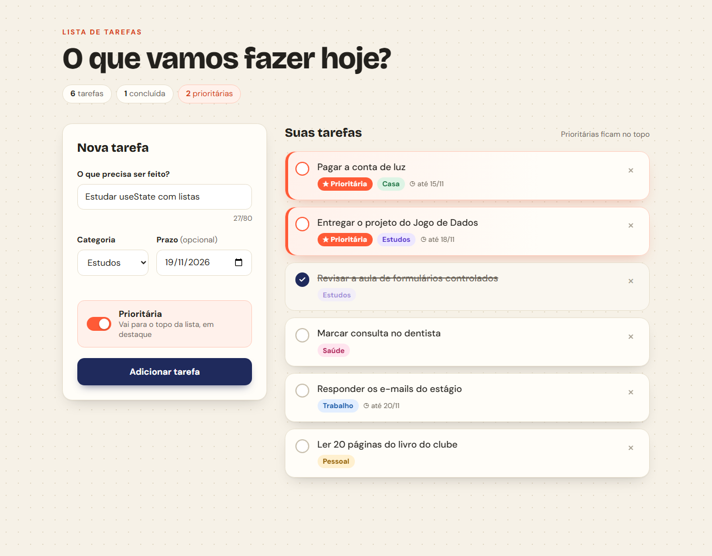

# Lista de Tarefas · Formulários no React

Atividade individual da unidade **ReactJS** (M3U3), para praticar
**formulários e eventos**. Você vai construir uma lista de tarefas: um
formulário para criar a tarefa (descrição, categoria, prazo e se ela é
prioritária) e uma lista onde dá para concluir e excluir cada uma.

A regra que dá graça ao projeto: **tarefas prioritárias entram no topo da
lista e aparecem em destaque**. As outras entram no fim.

O CSS vem pronto. **O projeto inteiro é React.**



As outras referências estão em `referencias/`: a lista vazia
(`01-lista-vazia.png`), o formulário com erros (`03-erros.png`) e a tela no
celular (`04-celular.png`).

---

## Antes de começar

1. Faça o fork, clone o **seu** fork e abra a pasta no VS Code. Se tiver
   dúvida, o passo a passo está no fim deste arquivo.
2. Confira se tem o Node instalado: `node -v` no terminal precisa mostrar a
   versão 20 ou maior.
3. **Leia `docs/01-entendendo-formularios.md` inteiro.** Ele explica, com
   exemplos, tudo o que este projeto usa: campo controlado, estado-objeto,
   `submit`, validação, e como incluir, alterar e excluir itens de uma lista
   no estado.

## O briefing

Uma turma de estudantes reclamou que as listas de tarefas dos aplicativos são
cheias de botão e de cadastro. O pedido: "quero uma lista simples, que abra
na hora. Escrevo a tarefa, escolho a categoria, coloco um prazo se tiver, e o
que é urgente fica em cima, bem destacado, para eu não esquecer".

O visual já está pronto no CSS e nas referências. O seu trabalho é o
formulário e a lista funcionarem com React.

## Sem `localStorage`, de propósito

As tarefas ficam **só no estado** do React. Recarregou a página, a lista volta
vazia. Isso não é um defeito do seu projeto: é uma escolha do enunciado.

O assunto aqui é **formulário e estado**. Guardar os dados de verdade é outro
assunto, e ele vai aparecer mais adiante, quando as tarefas forem para uma
API. Por isso, **não use `localStorage`, `sessionStorage` nem `useEffect`**.

## O que a aplicação precisa fazer

1. **Formulário "Nova tarefa"** com quatro campos:
   - **Descrição** (texto, obrigatória, de 3 a 80 letras), com um contador
     "27/80" embaixo;
   - **Categoria** (Estudos, Trabalho, Casa, Saúde ou Pessoal, obrigatória);
   - **Prazo** (data, opcional, não pode ser um dia que já passou);
   - **Prioritária** (um interruptor de liga e desliga).
2. **Validação**: ao enviar com problema, a mensagem aparece embaixo de cada
   campo errado. O botão fica desativado enquanto a descrição estiver vazia.
3. **Adicionar**: a tarefa válida entra na lista. **Prioritária vai para o
   topo; as outras, para o fim.** O formulário volta a ficar em branco.
4. **Lista**: cada tarefa mostra a descrição, a etiqueta da categoria, o prazo
   (se tiver) e, se for prioritária, o selo "Prioritária" e a cor de destaque.
5. **Concluir**: a caixinha marca e desmarca a tarefa como concluída (texto
   riscado).
6. **Excluir**: o "×" tira a tarefa da lista.
7. **Resumo** no topo: quantas tarefas, quantas concluídas e quantas
   prioritárias.
8. **Lista vazia**: sem tarefas, aparece o aviso "Nenhuma tarefa por aqui".

O comportamento em detalhe, com todas as mensagens, está em
`comportamento-interativo.md`. **Esse documento é a sua especificação.**

## O que você recebe

```
lista-de-tarefas/
├── recursos/
│   └── estilo.css ..................... estilo pronto (vai para src/)
├── docs/
│   ├── 01-entendendo-formularios.md ... campos controlados, submit, validação e listas no estado
│   └── 02-componentes.md .............. os componentes, as props e a marcação de cada um
├── referencias/
│   ├── 01-lista-vazia.png ............. ao abrir
│   ├── 02-com-tarefas.png ............. com tarefas, prioritárias no topo
│   ├── 03-erros.png ................... o formulário com erros
│   └── 04-celular.png ................. no celular
├── comportamento-interativo.md ........ como a aplicação deve reagir
└── README.md .......................... este arquivo
```

## O que você entrega

O projeto React funcionando, criado com Vite, no seu repositório:

```
src/
├── main.jsx ................. monta o React e importa o CSS
├── estilo.css
├── App.jsx .................. guarda a lista de tarefas e as funções que mudam a lista
├── utils/
│   ├── categorias.js ........ a lista de categorias
│   └── datas.js ............. a data de hoje e o prazo formatado
└── components/
    ├── Resumo.jsx
    ├── FormularioTarefa.jsx
    ├── ListaTarefas.jsx
    └── ItemTarefa.jsx
```

## Regras

1. **React com Vite**, sem TypeScript.
2. **Bibliotecas:** o projeto foi pensado para funcionar só com `react` e
   `react-dom`. Se quiser usar outra biblioteca (por exemplo, `react-icons`
   para os ícones), pode, desde que você anote no README qual instalou e por
   quê. Evite as bibliotecas de formulário (React Hook Form, Formik): elas
   fazem justamente o que este projeto quer que você aprenda a fazer à mão.
   Nem toda biblioteca é vista em aula: se escolher uma, a documentação dela é
   o seu material de estudo.
3. **Só um hook: `useState`.** Sem `useEffect`, sem `localStorage`.
4. **Todo campo é controlado**: tem `value` (ou `checked`) ligado ao estado e
   um `onChange`.
5. **Os campos do formulário ficam em um estado só** (um objeto), não em
   quatro `useState` separados.
6. **Nunca altere o estado direto.** Para incluir, use uma lista nova com
   spread; para alterar, `map`; para excluir, `filter`.
7. **O que dá para calcular não é estado**: o resumo, o contador de letras e
   o botão desativado saem do estado que já existe.
8. **Não edite o `estilo.css`** e **não use `style={{ }}`**. Use as classes de
   `docs/02-componentes.md`.
9. **Nenhuma manipulação direta do DOM** (`document.querySelector`,
   `innerHTML`, `.value =`). Nada de `alert()` ou `confirm()`.
10. Você pode usar IA como tutora, com o prompt da unidade, para tirar dúvidas
    e revisar o seu código. Não peça para ela fazer o projeto: você precisa
    entender e saber explicar cada trecho do que entregar.

## O que você vai desenvolver

Ao concluir este projeto você terá praticado:

**Formulários**
- Campos de texto, `select`, data e `checkbox` controlados pelo estado
- Um estado-objeto para o formulário e um `onChange` que serve para todos os
  campos, pelo `name`
- Validação por campo, com um objeto de erros e a mensagem embaixo de cada
  campo
- `aria-invalid` e `aria-describedby` para quem usa leitor de tela
- Voltar o formulário ao começo depois de enviar

**Eventos (`onClick`, `onChange`, `onSubmit`)**
- `onSubmit` com `preventDefault`
- `onChange` no texto, no `select`, na data e no `checkbox`
- `onClick` no "×" de cada tarefa, passando o `id` certo

**Hooks: `useState`**
- Uma lista no estado: incluir no começo ou no fim com spread, alterar com
  `map` e excluir com `filter`
- Um `id` para cada tarefa, usado na `key`
- Valores calculados (resumo, contador, botão desativado) em vez de estados
  repetidos

**Componentização e props**
- O formulário com o seu próprio estado, avisando o `App` por uma prop de
  função
- Funções passando por dois níveis de componentes (`App` → `ListaTarefas` →
  `ItemTarefa`)
- Classes que mudam conforme a tarefa (`tarefa--prioritaria`,
  `tarefa--concluida`)

**Build e deploy**
- Gerar a versão de produção e publicar a lista na internet

---

## Roteiro sugerido

As etapas estão na ordem que facilita a construção do projeto, não na ordem
das aulas. Cada uma mostra os **assuntos** que pratica: se algum ainda não foi
visto em aula, use as fontes de consulta do fim deste arquivo. Faça um commit
ao fim de cada etapa.

### Etapa 0 · Montar o projeto

*Assuntos: Criar um projeto inicial com arquivo JSX · Utilização do Vite*

Na pasta do repositório, crie o projeto React **dentro da própria pasta** (o
ponto no fim do comando é isso). Quando o Vite avisar que a pasta não está
vazia, escolha **"Ignore files and continue"**. Se ele fizer outras perguntas
(usar outra ferramenta de build, instalar e iniciar agora), responda **No**.

```
npm create vite@latest . -- --template react
npm install
npm run dev
```

Depois:

1. Mova `recursos/estilo.css` para `src/`.
2. No `main.jsx`, troque `import './index.css'` por `import './estilo.css'`.
3. Apague `src/index.css`, `src/App.css` e a pasta `src/assets/`.
4. Apague todo o conteúdo do `App.jsx` e deixe só um componente que devolve o
   título "O que vamos fazer hoje?".
5. No `index.html` da raiz, troque `<html lang="en">` por `<html lang="pt-BR">`
   e mude o `<title>` para `Lista de Tarefas`.

O título deve aparecer em letra grande, sobre um papel pontilhado. As fontes
vêm da internet: sem conexão, funciona igual, só com outra letra.

### Etapa 1 · A tela, sem estado

*Assuntos: Componentes funcionais · Componentização e reutilização · Props*

Monte a tela inteira com a marcação de `docs/02-componentes.md`, ainda sem
nenhum `useState`:

- o topo com o `Resumo` mostrando números fixos;
- o `FormularioTarefa` com os quatro campos, sem `value` nem `onChange` por
  enquanto, e as opções do `select` criadas com `map` a partir de
  `CATEGORIAS` (`src/utils/categorias.js`);
- a `ListaTarefas` recebendo um array de **exemplo** com três tarefas escrito
  no `App`, e um `ItemTarefa` para cada uma.

O `ItemTarefa` já decide as classes sozinho: `tarefa--prioritaria` se a
tarefa for prioritária, `tarefa--concluida` se estiver concluída, e o selo e o
prazo só aparecem quando existem.

`props` · `map` + `key` · `&&` · classes condicionais

### Etapa 2 · O formulário controlado

*Assuntos: Formulários · Eventos · Hooks: useState*

No `FormularioTarefa`, crie **um** estado-objeto com os quatro campos. Ligue
cada campo ao estado com `value` (ou `checked`) e escreva **uma** função
`atualizarCampo` que serve para todos, usando o `name` do campo.

Ligue também o que é **calculado** a partir desse estado:

- o contador "27/80" (e a classe de alerta a partir de 70 letras);
- o botão desativado enquanto a descrição estiver vazia.

Confira no React DevTools (ou com um `console.log` no corpo do componente) que
o estado muda a cada tecla.

`value` · `checked` · `onChange` · `name` · `[name]: valor` · `disabled`

### Etapa 3 · Enviar e validar

*Assuntos: Formulários · Eventos*

Escreva a função do `onSubmit`:

1. `preventDefault()`, para a página não recarregar;
2. valide os campos com as regras do `comportamento-interativo.md` e monte um
   objeto só com os erros;
3. com erro: guarde os erros em um estado e mostre cada mensagem embaixo do
   seu campo, com `aria-invalid` e `aria-describedby`;
4. sem erro: por enquanto, só um `console.log` da tarefa nova, e o formulário
   volta ao começo.

Quando a pessoa altera um campo com erro, a mensagem daquele campo some.

`onSubmit` · `preventDefault` · objeto de erros · `aria-invalid` · voltar ao estado inicial

### Etapa 4 · A lista de verdade

*Assuntos: Hooks: useState · Props*

Apague o array de exemplo. No `App`, crie o estado da lista (começando vazia)
e a função `adicionarTarefa(dados)`, que:

- monta a tarefa completa, com `id` (`crypto.randomUUID()`) e
  `concluida: false`;
- se for prioritária, coloca **no começo** da lista; se não, **no fim**.

Passe essa função para o `FormularioTarefa` por uma prop (`aoAdicionar`) e
troque o `console.log` da etapa 3 pela chamada a ela. Faça o `Resumo` calcular
os números a partir da lista, e a `ListaTarefas` mostrar o aviso de lista
vazia quando não houver tarefas.

`[nova, ...lista]` × `[...lista, nova]` · prop de função · estado derivado

### Etapa 5 · Concluir e excluir

*Assuntos: Eventos · Hooks: useState · Props*

No `App`, escreva `alternarConcluida(id)` (com `map`) e `excluirTarefa(id)`
(com `filter`). Passe as duas pela `ListaTarefas` até cada `ItemTarefa`. A
caixinha chama uma, o "×" chama a outra.

`map` · `filter` · props passando por dois componentes

### Etapa 6 · Conferir e publicar

*Assuntos: Build · Deploy*

Faça os testes da lista de entrega, compare com as referências (em tela larga
e no celular, pelo DevTools) e confira o console: nenhum aviso vermelho, nem o
de `key`. Depois, siga a seção [Publicação](#publicação).

---

## Evolução do projeto (opcional)

Depois que tudo da lista de entrega estiver funcionando, você pode continuar o
projeto. Nada aqui é obrigatório.

- **Filtro**: botões "Todas", "Pendentes" e "Concluídas" acima da lista. O
  filtro escolhido é um estado; a lista mostrada é **calculada**.
- **Limpar concluídas**: um botão que tira da lista todas as tarefas
  concluídas de uma vez.
- **Prazo atrasado**: quando o prazo já passou e a tarefa não foi concluída, o
  prazo fica vermelho. A classe `tarefa__prazo--atrasado` já está no CSS.
- **Concluídas descem**: ao concluir, a tarefa vai para o fim da lista; ao
  desmarcar, volta para o lugar do grupo dela (prioritárias em cima).
- **Editar**: um botão que coloca a tarefa de volta no formulário para ser
  alterada.
- **Cor por categoria** (*Estilização de componentes*): crie
  `ItemTarefa.module.css` com uma faixa colorida na lateral de cada tarefa, uma
  cor por categoria, sem mexer no `estilo.css`. Pense em como escolher a classe
  certa a partir de `tarefa.categoria` sem um `if` para cada uma.
- **Ícones** (*Utilização de bibliotecas*): instale `react-icons` e troque o
  "×" e o selo "Prioritária" por ícones. Mantenha o `aria-label` do botão: um
  ícone sozinho não diz nada para quem usa leitor de tela.

## Lista de entrega

- [ ] Ao abrir, a lista está vazia, com o aviso, e o resumo mostra "0 tarefas"
- [ ] Todos os campos são controlados, em um estado-objeto só
- [ ] O contador mostra as letras digitadas e fica laranja a partir de 70
- [ ] O botão fica desativado enquanto a descrição estiver vazia (ou só com espaços)
- [ ] Enviar com erro mostra as mensagens certas embaixo de cada campo
- [ ] Alterar um campo com erro faz a mensagem dele sumir
- [ ] Uma tarefa prioritária entra no **topo**; uma normal entra no **fim**
- [ ] As prioritárias aparecem com o selo e a cor de destaque
- [ ] Depois de adicionar, o formulário volta ao começo
- [ ] Concluir risca a tarefa, e desmarcar volta ao normal
- [ ] Excluir tira só aquela tarefa
- [ ] O resumo está sempre certo, com singular e plural
- [ ] Recarregar a página deixa a lista vazia (sem `localStorage`)
- [ ] Nenhum `style={{ }}`, `document.querySelector`, `alert` ou `confirm`
- [ ] Nenhum erro nem aviso vermelho no console (inclusive o de `key`)
- [ ] A lista está publicada, com o link na descrição do repositório

## Publicação

Quando tudo estiver funcionando, gere a versão de produção e publique.

**1. Build.** No terminal:

```
npm run build
npm run preview
```

O `build` cria a pasta `dist/` com o site pronto para a internet (HTML, CSS e
JS otimizados). O `preview` abre essa versão no navegador: confira se está
tudo igual ao `npm run dev`. A pasta `dist/` não vai para o GitHub (já está no
`.gitignore`): quem publica gera a sua própria.

**2. Deploy.** Escolha um dos caminhos:

- **Vercel ou Netlify** (o mais simples): entre com a sua conta do GitHub,
  importe o repositório e confirme. O Vite é detectado sozinho (*build command*
  `npm run build`, pasta de saída `dist`). A cada `git push`, o site é
  publicado de novo.
- **GitHub Pages**: o site fica em `https://SEU-USUARIO.github.io/NOME-DO-REPO/`,
  numa subpasta. Antes do build, acrescente `base: "/NOME-DO-REPO/"` no
  `vite.config.js` (sem isso, a página abre em branco) e publique a pasta
  `dist/` com um fluxo do GitHub Actions.

Coloque o link do site publicado na descrição do repositório (a engrenagem ao
lado de *About*).

**Documentação:**
- [GitHub Pages: criar um site](https://docs.github.com/pt/pages/getting-started-with-github-pages/creating-a-github-pages-site)
  e [publicar com um fluxo de trabalho](https://docs.github.com/pt/pages/getting-started-with-github-pages/using-custom-workflows-with-github-pages),
  em português
- [Vite: publicar um site estático](https://vite.dev/guide/static-deploy), com
  o passo a passo de GitHub Pages, Vercel e Netlify
- [Vercel com Vite](https://vercel.com/docs/frameworks/frontend/vite) e
  [Netlify com Vite](https://docs.netlify.com/frameworks/vite/)

A Vite, a Vercel e a Netlify não têm documentação em português. O tradutor do
navegador dá conta.

## Como fazer o fork

**1. Faça o fork.** No topo desta página, clique em **Fork** e em **Create
fork**.

**2. Clone a SUA cópia.** Confira que o endereço tem o seu usuário, não o da
escola:

```
git clone https://github.com/SEU-USUARIO/lista-de-tarefas.git
cd lista-de-tarefas
```

**3. Trabalhe em commits pequenos**, um por etapa do roteiro, e envie:

```
git add .
git commit -m "etapa 2: formulário controlado"
git push
```

---

## Fontes de consulta

Em português, a não ser quando indicado.

- [GitHub: criar fork de um repositório](https://docs.github.com/pt/pull-requests/collaborating-with-pull-requests/working-with-forks/fork-a-repo)
- [react.dev: Respondendo a eventos](https://pt-br.react.dev/learn/responding-to-events)
- [react.dev: Reagindo à entrada de dados com state](https://pt-br.react.dev/learn/reacting-to-input-with-state)
- [react.dev: o componente `<input>`](https://pt-br.react.dev/reference/react-dom/components/input) (campos controlados, `checked`, `onChange`)
- [react.dev: Atualizando arrays no state](https://pt-br.react.dev/learn/updating-arrays-in-state)
- [react.dev: Renderizando listas](https://pt-br.react.dev/learn/rendering-lists) (por que a `key` é o `id`)
- [MDN: aria-invalid](https://developer.mozilla.org/en-US/docs/Web/Accessibility/ARIA/Reference/Attributes/aria-invalid) (em inglês)
