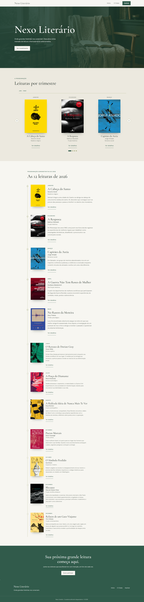

# Nexo Literário · O site completo em React


Projeto individual da unidade **ReactJS** (M3U3). Na M3U2 você montou a Home
e os Planos do Nexo Literário com JavaScript puro. Agora o clube quer o **site
completo**: a programação do ano, a página de cada livro, o histórico de
leituras com as notas, os planos e o formulário de assinatura. Tudo
isso em React, com rotas, e com os dados vindo de uma API.

O CSS e os ícones vêm prontos. **O projeto inteiro é React.**



As outras telas estão em `referencias/`: O Clube (`02-clube.png`), a página do
livro (`03-livro.png`), Assinar (`04-assinar.png`), os dois estados de erro
da página do livro (`05-livro-nao-encontrado.png` e `06-livro-erro.png`) e O
Clube no celular (`07-clube-celular.png`).

Os planos, no fim do Clube, usam **o mesmo cartão da página Planos do
M3U2-02**, com um botão "Assinar" a mais no pé.

---

## Antes de começar

1. Faça o fork, clone o **seu** fork e abra a pasta no VS Code. Se tiver
   dúvida, o passo a passo está no fim deste arquivo.
2. Confira se tem o Node instalado: `node -v` no terminal precisa mostrar a
   versão 20 ou maior.
3. Leia a seção **"A API deste projeto"**, logo abaixo. Ela explica de onde
   vêm os dados e o que vai mudar no Módulo 4.
4. Siga a **Etapa 0** do roteiro para criar o projeto React dentro desta pasta.

## A API deste projeto

> **A API de verdade ainda não existe. Você vai construí-la depois, no
> Módulo 4 (Backend).**

Em um site real, os livros, os planos e as assinaturas ficariam em um banco de
dados, e um servidor (o **backend**) entregaria esses dados por uma API. Esse
servidor ainda não existe: ele é o assunto do Módulo 4, e quem vai escrevê-lo
é **você**.

Até lá, a API é **simulada** com o **json-server**. Ele lê o arquivo
`api/db.json` e responde às requisições **como se fosse** um servidor de
verdade: tem rotas, devolve JSON, responde 404 quando algo não existe e guarda
o que você envia com `POST`.

O seu React não fica sabendo que a API é simulada. Ele faz `fetch`, confere o
`response.ok` e lê o JSON exatamente como faria com o servidor do Módulo 4.
Quando a sua API ficar pronta, com **as mesmas rotas e o mesmo formato de
dados**, a troca vai ser uma linha: o endereço guardado em `VITE_API_URL`.

Por isso, vale fazer o consumo da API com cuidado agora:

- todas as chamadas ficam em **um arquivo só** (`src/services/api.js`);
- o endereço da API vem **sempre** da variável de ambiente, nunca escrito à
  mão dentro dos componentes;
- toda tela que busca dados sabe mostrar **carregando, erro e vazio**.

As rotas e os formatos estão em `docs/02-guia-da-api.md`.

## O briefing

O **Nexo Literário** é um clube de leitura por assinatura, com curadoria
editorial independente: um livro por mês, doze por ano. O slogan é **"Onde
grandes histórias nos conectam"**.

A versão da M3U2 deu certo: a editora troca um livro ou um preço nos dados e
o site muda sozinho. O pedido agora:

> "Quero que a pessoa conheça cada livro com calma, veja o que a turma achou
> das leituras passadas, compare os planos e assine ali mesmo, sem precisar
> mandar mensagem."

A designer entregou as telas (em `referencias/`), e o time de backend já
combinou as rotas e o formato dos dados. Falta o frontend. Esse é o seu
trabalho.

O pedido completo, os textos e as mensagens aprovadas estão em
`docs/01-briefing-do-cliente.md`.

## O que a aplicação precisa ter

| Rota | Tela | O que mostra |
| --- | --- | --- |
| `/` | Início | abertura, carrossel "Leituras por trimestre" e linha do tempo do ano |
| `/clube` | O Clube | pilares, encontros, histórico de livros já lidos (com notas) e os planos, com o cartão do M3U2-02 |
| `/livros/:identificador` | Livro | ficha completa, com anterior e próximo |
| `/assinar` | Assinar | formulário com plano, modalidade e pagamento, e o resumo ao lado |
| qualquer outra | Página não encontrada | aviso e link para o início |

O comportamento de cada tela está em `comportamento-interativo.md`. **Esse
documento é a sua especificação**: leia inteiro antes de começar.

## Você já fez parte disso

Na M3U2 você escreveu **funções-componente**: funções que recebiam um objeto
e devolviam um elemento pronto. Elas são o ponto de partida dos componentes
React deste projeto. A lógica (ordenar, agrupar por trimestre, formatar o mês,
calcular os preços em centavos) continua a mesma. O que muda é **como a tela
é desenhada**.

| No M3U2-02 (JavaScript puro) | Aqui (React) |
| --- | --- |
| `criarCartaoDoLivro(livro)` devolve um `<article>` | `<CartaoLivro livro={livro} />` |
| `criarItemDaLinhaDoTempo(livro)` devolve um `<li>` | `<ItemLinhaDoTempo livro={livro} />` |
| `criarCartaoDoPlano(plano)` devolve um `<article>` | `<CartaoPlano plano={plano} />`, com a **mesma marcação** e um botão a mais |
| função para a capa ou "Capa indisponível" | `<CapaLivro livro={livro} className="..." />` |
| `let indiceAtivo` + `mostrar(indice)` troca classes | `const [indice, setIndice] = useState(0)` e o JSX decide as classes |
| `elemento.hidden = true` para trocar de estado | renderização condicional: `{carregando && <p>...</p>}` |
| `formatarMes(mes)`, contas em centavos | as **mesmas funções**, agora em `src/utils/` |

Abra o seu repositório do M3U2-02 ao lado deste. Copiar as suas funções de
formatação e de cálculo para `src/utils/` é permitido e esperado. Os
componentes você reescreve em JSX.

## O que você recebe

```
nexo-literario/
├── api/
│   └── db.json .................... banco da API simulada (livros, planos, assinaturas)
├── recursos/
│   ├── style.css .................. estilo pronto (vai para src/)
│   ├── README-estilo.md ........... guia das classes de cada tela
│   └── Icones.jsx ................. ícones prontos em JSX (vai para src/components/)
├── docs/
│   ├── 01-briefing-do-cliente.md .. pedido, textos e mensagens aprovadas
│   ├── 02-guia-da-api.md .......... json-server, rotas e formato dos dados
│   ├── 03-telas-e-componentes.md .. pastas, componentes, contexto e a marcação de cada tela
│   └── 04-dados-e-calculos.md ..... meses, trimestres, preços, notas e pagamento
├── referencias/ ................... imagens de referência das telas
├── comportamento-interativo.md .... como cada tela deve reagir
├── TUTOR-M3.md .................... prompt do tutor de IA do módulo (veja "Regras")
└── README.md ...................... este arquivo
```

## O que você entrega

1. O projeto React funcionando, criado com Vite, no seu repositório.
2. O **README do seu projeto** reescrito, no modelo da seção
   "[Documentação do seu projeto](#documentação-do-seu-projeto)", no fim deste
   arquivo, com imagens das telas rodando na sua máquina.

Este projeto **não precisa ser publicado**: a API roda só na sua máquina até
você construir a sua no Módulo 4. Mas a versão de produção precisa funcionar:
na última etapa, você gera o build e confere com o `npm run preview`.

## Regras

1. **React com Vite**, sem TypeScript.
2. **Bibliotecas:** o projeto foi pensado para `react`, `react-dom`,
   `react-router-dom` e, só como dependência de desenvolvimento,
   `json-server@0.17.4`. Tudo o que ele pede dá para fazer só com elas. Se
   quiser usar outra biblioteca, pode, desde que você anote no README qual
   instalou e por quê, e que ela não faça por você o que o projeto quer
   exercitar:
   - as chamadas à API usam `fetch`, porque tratar a resposta é parte do
     exercício (axios esconde o `response.ok`);
   - o formulário e o carrossel são feitos à mão, com estado (evite bibliotecas
     de formulário e de carrossel).

   Ícones, notificações e animações são bons lugares para experimentar uma
   biblioteca. Nem toda biblioteca é vista em aula: se escolher uma, a
   documentação dela é o seu material de estudo.
3. **Hooks do projeto:** `useState`, `useEffect`, `useContext` e os do React
   Router (`useParams`, `useSearchParams`). Não é preciso criar hooks próprios.
4. **Todas as chamadas à API com `fetch` e `async`/`await`**, com `try`/`catch`
   e conferência do `response.ok`, e todas dentro de `src/services/api.js`.
   Nenhum componente faz `fetch` direto.
5. **O endereço da API vem da variável de ambiente** `VITE_API_URL`.
6. **Os dados vêm da API.** Depois da Etapa 4, nenhuma lista de livros ou de
   planos copiada no código e nenhum preço escrito à mão: tudo é calculado a
   partir do que a API devolve.
7. **Formulários controlados:** todo campo tem `value` (ou `checked`) ligado a
   um estado e um `onChange`.
8. **Não edite o `style.css`.** Use as classes do guia. **Nada de
   `style={{ }}`** nos componentes.
9. **Nenhuma manipulação direta do DOM** (`document.querySelector`,
   `innerHTML`, `classList`) dentro dos componentes. No React, a tela é
   consequência do estado.
10. **Sem `alert()`, `confirm()` ou `prompt()`.** Toda mensagem aparece na
    própria página.
11. **Os dados do cartão nunca vão para a API.** Número, nome impresso,
    validade e CVV só existem no formulário (veja `docs/02-guia-da-api.md`).
12. Você pode usar IA como tutora, com o prompt do tutor do módulo
    (`TUTOR-M3.md`, nesta pasta), para tirar dúvidas
    e revisar o seu código. Não peça para ela fazer o projeto: você precisa
    entender e saber explicar cada trecho do que entregar.

## O que você vai desenvolver

Ao concluir este projeto você terá praticado:

**Componentes funcionais, componentização e reutilização**
- Transformar as funções-componente do M3U2 em componentes com props
- Reaproveitar o mesmo componente em telas diferentes: o `Carrossel` serve à
  Home e ao Clube, a `CapaLivro` aparece em quatro lugares
- Listas com `map` e `key`, renderização condicional

**Props**
- Props de dado, de função e `children`
- Um componente que não sabe o que mostra (o `Carrossel` recebe os slides
  prontos)

**Hooks: `useState`**
- O slide visível do carrossel e o menu do celular
- Valores **derivados** do estado (o resumo da assinatura) em vez de estados
  repetidos

**Hooks: `useEffect`**
- Buscar dados ao abrir a tela e de novo quando um parâmetro muda
- A lista de dependências e a função `async` dentro do efeito
- Estados de carregando, erro (com "Tentar de novo") e vazio

**Hooks: `useContext`**
- Um `ClubeContext` que busca livros e planos **uma vez** e entrega para as
  quatro telas que precisam deles
- Decidir onde cada estado deve morar

**Formulários e eventos**
- Um formulário controlado com estado-objeto, validação e mensagens por campo
- Campos que aparecem e somem conforme a forma de pagamento
- Estado de "enviando" e falha no envio sem perder o que foi digitado

**React Router DOM**
- Layout comum com `Outlet`, `NavLink` e página 404
- Rota com parâmetro (`useParams`)
- Parâmetro na URL para pré-selecionar o plano (`useSearchParams`)

**Consumo de API**
- `GET` de coleções, `GET` com filtro e `POST` com `fetch`, em uma camada de
  serviço (`services/api.js`)
- Variáveis de ambiente no Vite (`VITE_API_URL`)

**Build**
- Gerar a versão de produção e conferir que ela funciona igual à de
  desenvolvimento

---

## Roteiro sugerido

As etapas estão na ordem que facilita a construção do projeto, não na ordem
das aulas. Cada uma mostra os **assuntos** que pratica: se algum ainda não foi
visto em aula, use as fontes de consulta do fim deste arquivo. Faça um commit
ao fim de cada etapa.

### Etapa 0 · Montar o projeto

*Assuntos: Criar um projeto inicial com arquivo JSX · Utilização do Vite · Utilização de bibliotecas*

Na pasta do repositório, crie o projeto React **dentro da própria pasta** (o
ponto no fim do comando é isso). Quando o Vite avisar que a pasta não está
vazia, escolha **"Ignore files and continue"**. Se ele fizer outras perguntas
(usar outra ferramenta de build, instalar e iniciar agora), responda **No**.

```
npm create vite@latest . -- --template react
npm install
npm install react-router-dom
npm install -D json-server@0.17.4
```

Depois:

1. Mova `recursos/style.css` para `src/` e importe no `main.jsx`. Apague o
   `index.css` e o `App.css` que vieram do Vite.
2. Mova `recursos/Icones.jsx` para `src/components/`.
3. No `index.html` da raiz, troque `<html lang="en">` por `<html lang="pt-BR">`,
   mude o `<title>` para `Nexo Literário` e cole no `<head>` as fontes:

   ```html
   <link rel="preconnect" href="https://fonts.googleapis.com" />
   <link rel="preconnect" href="https://fonts.gstatic.com" crossorigin />
   <link rel="stylesheet" href="https://fonts.googleapis.com/css2?family=Cormorant+Garamond:wght@400;500;600&family=DM+Sans:wght@400;500;600&display=swap" />
   ```

4. Crie um arquivo `.env` na raiz com o endereço da API:

   ```
   VITE_API_URL=http://localhost:3001
   ```

5. No `package.json`, dentro de `"scripts"`, acrescente:

   ```json
   "api": "json-server --watch api/db.json --port 3001"
   ```

A partir daqui, o projeto roda com **dois terminais abertos**: `npm run api`
em um e `npm run dev` no outro. Confira a API abrindo
`http://localhost:3001/livros` no navegador.

As capas dos livros e a foto da abertura não estão no projeto: ficam
hospedadas no GitHub, e o `db.json` já traz o link completo de cada capa.
Mantenha a internet ligada para elas aparecerem.

> O `json-server` escreve no `db.json` toda vez que a aplicação cria uma
> assinatura. Se os dados ficarem bagunçados durante os testes, volte ao
> original com `git checkout api/db.json`.

### Etapa 1 · Componentes estáticos

*Assuntos: Componentes funcionais · Componentização e reutilização · Props*

Ainda sem API e sem rotas. Copie **temporariamente** os livros do `db.json`
para um array dentro do código e monte a **Início** inteira com componentes:
`Topo`, `Rodape`, `Destaque` (a abertura), `CapaLivro`, `CartaoLivro`,
`ItemLinhaDoTempo` e `LinhaDoTempo`. Por enquanto o carrossel mostra só o
primeiro trimestre, sem setas.

Comece pela `CapaLivro`: ela decide sozinha se mostra a `` ou o
"Capa indisponível". Use as suas funções do M3U2 para o mês por extenso e para
agrupar por trimestre, agora em `src/utils/`.

`props` · `children` · `map` + `key` · `&&` · ternário · `className`

### Etapa 2 · Estado

*Assuntos: Hooks: useState · Eventos · Props*

Dê vida ao que muda na tela:

- **Carrossel:** o índice do slide visível vira um `useState`. Setas e pontos
  só mudam o índice; o JSX decide qual slide tem `carrossel__item--ativo`.
  Escreva o `Carrossel` de um jeito que **não saiba o que está mostrando**: ele
  recebe a lista de slides, cada um com o rótulo e o conteúdo já em JSX
  (`docs/03-telas-e-componentes.md`). Assim ele serve para a Home e, depois,
  para o histórico do Clube.
- **Menu do celular:** aberto ou fechado.
- **O Clube:** monte a tela com os livros e os planos copiados. O histórico
  usa o **mesmo** `Carrossel`, só com os livros que têm nota. Os planos usam o
  `CartaoPlano`, com a mesma marcação do seu `criarCartaoDoPlano` do M3U2-02,
  agora em JSX, e o botão "Assinar" no pé.

`useState` · eventos · passar funções como props · `%` para dar a volta

### Etapa 3 · Formulário controlado

*Assuntos: Formulários · Eventos · Hooks: useState*

Monte a tela **Assinar**: dados pessoais, botões de plano, modalidade, forma
de pagamento e campos do cartão. Todo campo é controlado. O **resumo** ao lado
não tem estado próprio: ele é **calculado** a partir do que já está no estado
do formulário.

Faça todas as validações do `comportamento-interativo.md`. Por enquanto, o
envio só mostra no console o objeto que **seria** enviado para a API (sem os
dados do cartão).

`value` + `onChange` · estado-objeto · `checked` · validação no `submit` · valores derivados

### Etapa 4 · A API

*Assuntos: Hooks: useEffect · consumo de API (revisão da M3U2)*

Suba a API (`npm run api`), leia `docs/02-guia-da-api.md` e **apague os arrays
copiados**. A Início e o Clube passam a buscar livros e planos com `fetch`
dentro de um `useEffect`, com carregando, erro (com "Tentar de novo") e vazio.

Crie desde já o `src/services/api.js` com uma função por rota (`listarLivros`,
`listarPlanos`...). Os componentes chamam essas funções; nenhum faz `fetch`
direto.

`useEffect` · lista de dependências · função `async` dentro do efeito · `import.meta.env`

### Etapa 5 · Rotas

*Assuntos: React Router DOM · Hooks: useEffect*

Instale as rotas da tabela do início deste arquivo. Topo e rodapé ficam em um
**layout** comum com `Outlet`, e o menu usa `NavLink`.

- A página do livro lê o `identificador` da URL e busca o livro na API
  (`GET /livros?identificador=...`). Ela tem os três desfechos das referências:
  o livro, "Livro não encontrado" e o erro com "Tentar de novo".
- Os botões "Assinar trimestral", "Assinar semestral"... do Clube levam para
  `/assinar?plano=trimestral` etc., e a tela Assinar abre com aquele plano
  escolhido.
- "Ver detalhes" leva para a página de cada livro.

`createBrowserRouter` ou `BrowserRouter` · `Outlet` · `Link` · `NavLink` · `useParams` · `useSearchParams`

### Etapa 6 · Enviar a assinatura

*Assuntos: Formulários · Eventos · consumo de API*

O "Confirmar assinatura" agora faz `POST /assinaturas`. Enquanto envia, o
botão mostra "Confirmando…" e fica desativado. Se der certo, a tela troca pela
confirmação. Se der errado, a mensagem de falha aparece e **o que a pessoa
digitou continua lá**.

`method` · `headers` · `body` + `JSON.stringify` · estado de "enviando" · `response.ok`

### Etapa 7 · Contexto

*Assuntos: Hooks: useContext*

Olhe para o seu código: a Início busca os livros, o Clube busca os livros e os
planos, a página do livro precisa da lista inteira para saber o anterior e o
próximo, e a Assinar busca os planos. São as mesmas duas buscas repetidas em
quatro telas.

Crie o `ClubeContext`: um Provider que busca livros e planos **uma vez**, ao
abrir o site, e entrega para quem precisar com `useContext`. O contrato do
contexto está em `docs/03-telas-e-componentes.md`. Depois, apague as buscas
repetidas das páginas.

`createContext` · Provider · `useContext` · onde cada estado deve morar

### Etapa 8 · Acabamento, build e documentação

*Assuntos: Build*

Faça os testes da seção "Testar os casos difíceis" de
`docs/02-guia-da-api.md`, compare cada tela com as referências em tela larga e
no celular e passe pela lista de entrega.

Depois, gere a versão de produção e confira, com a API ligada:

```
npm run build
npm run preview
```

O `build` cria a pasta `dist/` com o site otimizado, e o `preview` abre essa
versão (em outra porta, normalmente `http://localhost:4173`). Navegue por todas
as rotas. A variável `VITE_API_URL` é lida **no momento do build**: se você
mudar o `.env`, precisa gerar o build de novo.

Por fim, reescreva o README.

---

## Evolução do projeto (opcional)

Depois que tudo da lista de entrega estiver funcionando, você pode continuar o
projeto. Nada aqui é obrigatório.

- **Título da aba** muda em cada página ("Capitães da Areia — Nexo Literário").
- **CPF de verdade:** validar os dígitos verificadores, não só a quantidade.
- **Máscaras** no CPF (`000.000.000-00`), no cartão (`0000 0000 0000 0000`) e
  na validade (`MM/AA`) enquanto a pessoa digita.
- **E-mail repetido:** antes de enviar, buscar `GET /assinaturas?email=...` e
  avisar se aquele e-mail já tem uma assinatura.
- **Teclado no carrossel:** as setas ← e → trocam o slide quando o foco estiver
  nele.
- **Filtro por categoria** na linha do tempo, guardado na URL
  (`/?categoria=Thriller+jurídico`).
- **Aviso de assinatura confirmada** (*Utilização de bibliotecas*): instale
  `react-toastify` e mostre uma notificação quando a assinatura for criada.
  Leia a documentação para descobrir onde o `ToastContainer` precisa ficar
  para funcionar em todas as rotas.
- **Página do livro com estilo próprio** (*Estilização de componentes*): crie
  um `PaginaLivro.module.css` para um detalhe novo da página do livro (por
  exemplo, a ficha em duas colunas no computador), sem tocar no `style.css`.
  Compare com o CSS global: quando vale a pena usar cada um?
- **Publicar** (*Deploy*): publique o frontend na Vercel ou na Netlify e a API
  no Render, como no projeto Raiz & Cia. Leia a seção de publicação dele para
  saber o ajuste de rotas (`vercel.json`) e o comando do json-server no Render.

## Lista de entrega

- [ ] As cinco rotas da tabela existem, com topo e rodapé em comum
- [ ] O link da página atual aparece marcado no menu
- [ ] A Início mostra o carrossel por trimestre e a linha do tempo com os 12 livros
- [ ] O mesmo componente `Carrossel` é usado na Início e no Clube
- [ ] O Clube mostra o histórico só com os livros que têm nota, com as estrelas
- [ ] Os planos do Clube usam o cartão do M3U2-02, com os valores de `docs/04-dados-e-calculos.md`
- [ ] O selo "Mais escolhido" aparece só no plano com `destaque: true`
- [ ] "Ver detalhes" abre a página certa, com anterior e próximo
- [ ] `/livros/nao-existe` mostra "Livro não encontrado"
- [ ] Com a API desligada, toda tela que busca dados mostra o erro e o "Tentar de novo" funciona
- [ ] Com uma coleção vazia no `db.json`, aparece o aviso de vazio
- [ ] Nenhum `undefined` ou `null` na tela (livros sem páginas, sem nota, sem capa)
- [ ] `/assinar?plano=anual` abre com o Anual escolhido
- [ ] O formulário valida todos os campos e mostra a mensagem embaixo de cada um
- [ ] Parcelado só aceita cartão; Pix e boleto mostram a ajuda certa e escondem os campos do cartão
- [ ] A assinatura é criada na API (confira em `http://localhost:3001/assinaturas`) **sem** os dados do cartão
- [ ] Livros e planos são buscados uma vez, no `ClubeContext`
- [ ] Todas as chamadas estão em `services/api.js`, com `VITE_API_URL`
- [ ] Nenhum erro nem aviso vermelho no console (inclusive o de `key`)
- [ ] `npm run build` termina sem erro, e o `npm run preview` funciona igual ao `npm run dev`
- [ ] README reescrito, com imagens das telas

## Documentação do seu projeto

O README que veio com este repositório é o **enunciado**. Na entrega, ele dá
lugar ao README do **seu projeto**, escrito para quem nunca viu o código. Mova
o enunciado para `docs/00-enunciado.md`, para não perder.

O seu README precisa ter, nesta ordem:

1. **Nome e uma frase** dizendo o que a aplicação faz.
2. **Imagens**: pelo menos três telas, uma delas no celular.
3. **Funcionalidades**: a lista do que dá para fazer, em linguagem de quem usa.
4. **Tecnologias**: React, Vite, React Router e json-server.
5. **Como rodar na sua máquina**: requisitos, instalação, o `.env` e os dois
   terminais.
6. **Estrutura de pastas**: a árvore do `src/` com uma linha explicando cada
   pasta.
7. **Rotas da aplicação** e **rotas da API que ela consome**.
8. **De JavaScript puro para React**: compare uma função-componente sua do
   M3U2 com o componente que a substituiu. O que ficou mais simples? O que
   ficou diferente?
9. **Decisões e aprendizados**: duas ou três decisões que você tomou e por quê
   (ex.: "os livros ficam no contexto porque quatro telas usam"), e o que foi
   mais difícil.
10. **Próximos passos**: o que você faria com mais tempo. A troca do json-server
    pela API que você vai construir no Módulo 4 é um deles.

---

## Como fazer o fork

**1. Faça o fork.** No topo desta página, clique em **Fork** e em **Create
fork**.

**2. Clone a SUA cópia.** Confira que o endereço tem o seu usuário, não o da
escola:

```
git clone https://github.com/SEU-USUARIO/nexo-literario-react.git
cd nexo-literario-react
```

**3. Trabalhe em commits pequenos**, um por etapa do roteiro, e envie:

```
git add .
git commit -m "etapa 2: carrossel com useState"
git push
```

O `.env` não deve ir para o GitHub: confira se ele está no `.gitignore` (o Vite
já coloca `*.local`, mas não `.env`). Para mostrar a quem clonar quais variáveis
existem, crie um `.env.example` com a mesma linha, esse sim versionado.

---

## Fontes de consulta

Em português, a não ser quando indicado.

- [GitHub: criar fork de um repositório](https://docs.github.com/pt/pull-requests/collaborating-with-pull-requests/working-with-forks/fork-a-repo)
- [react.dev: Aprenda React](https://pt-br.react.dev/learn), o guia completo.
  Para este projeto, principalmente:
  [Passando props a um componente](https://pt-br.react.dev/learn/passing-props-to-a-component),
  [State, a memória de um componente](https://pt-br.react.dev/learn/state-a-components-memory),
  [Reagindo à entrada de dados com state](https://pt-br.react.dev/learn/reacting-to-input-with-state),
  [useEffect](https://pt-br.react.dev/reference/react/useEffect) e
  [useContext](https://pt-br.react.dev/reference/react/useContext). Algumas
  páginas do site em português ainda estão em inglês.
- [React Router](https://reactrouter.com/start/declarative/installation) (em inglês)
- [json-server 0.17](https://github.com/typicode/json-server/tree/v0.17.4) (em inglês)
- [Vite: variáveis de ambiente](https://vite.dev/guide/env-and-mode) e
  [build para produção](https://vite.dev/guide/build) (em inglês)
- [MDN: usando Fetch](https://developer.mozilla.org/pt-BR/docs/Web/API/Fetch_API/Using_Fetch)
- [MDN: Intl.DateTimeFormat](https://developer.mozilla.org/en-US/docs/Web/JavaScript/Reference/Global_Objects/Intl/DateTimeFormat) (em inglês)
