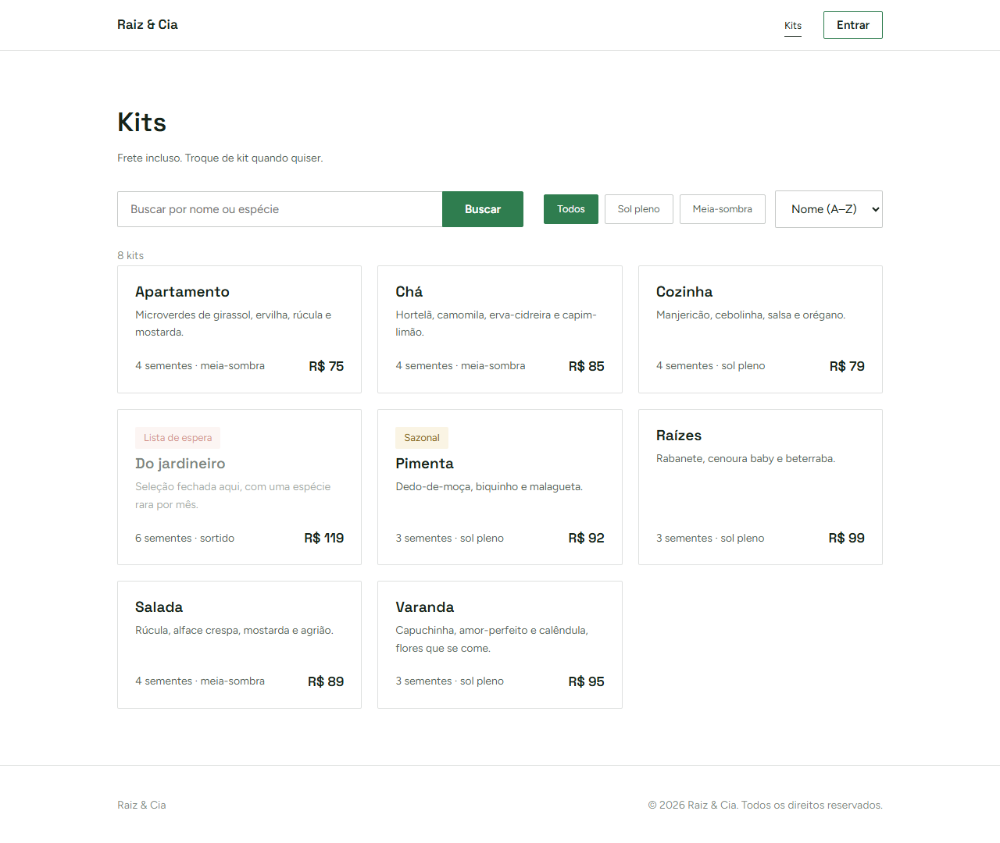

# Raiz & Cia · Área do assinante

Projeto final individual da unidade **ReactJS** (M3U3). Você vai construir em
React a aplicação de assinatura da Raiz & Cia: catálogo de kits, página de
cada kit, cadastro, login, formulário de assinatura com busca de endereço pelo
CEP e uma área onde a pessoa gerencia as próprias assinaturas.

A API é simulada com o **json-server**, a partir de um banco pronto. No Módulo
4 você vai construir a API de verdade, com as mesmas rotas, e este mesmo
frontend vai passar a conversar com ela.

O CSS vem pronto. **O projeto inteiro é React.**



---

## Antes de começar

1. Faça o fork, clone o **seu** fork e abra a pasta no VS Code.
2. Confira se tem o Node instalado: `node -v` no terminal precisa mostrar a
   versão 20 ou maior.
3. Siga a **Etapa 0** do roteiro (mais abaixo) para criar o projeto React
   dentro desta pasta e ligar a API.

## O briefing

Você já conhece a **Raiz & Cia** do Módulo 2: a lojinha que vende kits de
sementes por assinatura e que perdia pedidos porque tudo passava pelo direct
do Instagram. A página que você fez naquela época deu certo. Deu tão certo que
criou um problema novo.

Agora são mais de trezentos assinantes, e cada pausa, troca de kit ou
cancelamento ainda chega por mensagem. A dona, a Lúcia, passa as manhãs
copiando endereços para uma planilha. O pedido dela:

> "Quero que a pessoa entre, escolha o kit, assine e depois resolva a vida
> dela sozinha: pausar nas férias, trocar de kit, cancelar. Sem me chamar."

A designer manteve a identidade do site anterior. A equipe de backend vai
entregar a API no mês que vem, mas já combinou as rotas e o formato dos dados.
Até lá, você trabalha com uma API simulada que responde exatamente do mesmo
jeito.

O pedido completo, os textos e as mensagens aprovadas estão em
`docs/01-briefing-do-cliente.md`.

## O que a aplicação precisa ter

| Rota | Tela | Acesso |
| --- | --- | --- |
| `/` | Início: abertura, kits em destaque e como funciona | livre |
| `/kits` | Catálogo com busca, filtro por luz e ordenação | livre |
| `/kits/:id` | Página do kit | livre |
| `/entrar` | Login | livre |
| `/cadastro` | Criar conta | livre |
| `/assinar/:kitId` | Formulário de assinatura | **só logado** |
| `/minha-conta` | Minhas assinaturas: pausar, retomar, trocar kit e cancelar | **só logado** |
| qualquer outra | Página não encontrada | livre |

O comportamento de cada tela está em `comportamento-interativo.md`. **Esse
documento é a sua especificação**: leia inteiro antes de começar.

## O que você recebe

```
raiz-e-cia-assinante/
├── api/
│   └── db.json .................... banco da API simulada (kits, usuários, assinaturas)
├── recursos/
│   ├── estilo-base.css ............ estilo pronto (vai para src/)
│   ├── README-estilo-base.md ...... guia das classes e variáveis do estilo
│   └── img/mudas.png .............. foto da abertura (vai para public/)
├── docs/
│   ├── 01-briefing-do-cliente.md .. pedido, textos e mensagens aprovadas
│   ├── 02-guia-da-api.md .......... rotas da API simulada e do ViaCEP
│   └── 03-telas-e-componentes.md .. rotas, componentes sugeridos e marcação de cada tela
├── referencias/ ................... imagens de referência das telas
├── vitrine/
│   ├── index.html ................. todos os componentes do estilo, nos três temas
│   └── img/ ....................... imagens usadas só na vitrine
├── comportamento-interativo.md .... como cada tela deve reagir
├── TUTOR-M3.md .................... prompt do tutor de IA do módulo (veja "Regras")
└── README.md ...................... este arquivo
```

O guia completo das classes do CSS está em `recursos/README-estilo-base.md`.
O projeto usa o tema **Raiz** (`data-tema="raiz"`).

## O que você entrega

1. O projeto React funcionando, criado com Vite, no seu repositório.
2. O **frontend publicado** na Vercel ou na Netlify.
3. A **API publicada** no Render, com o passo a passo da Etapa 8. Se não
   conseguir publicar a API, grave um vídeo de até 3 minutos mostrando o fluxo
   completo rodando na sua máquina e coloque o link no README.
4. O **README do seu projeto** reescrito, no modelo da seção
   "[Documentação do seu projeto](#documentação-do-seu-projeto)", no fim deste
   arquivo.

## Regras

1. **React com Vite**, sem TypeScript.
2. **Bibliotecas:** o projeto foi pensado para `react`, `react-dom`,
   `react-router-dom` e, só como dependência de desenvolvimento,
   `json-server@0.17.4`. Tudo o que ele pede dá para fazer só com elas. Se
   quiser usar outra biblioteca, pode, desde que você anote no README qual
   instalou e por quê, e que ela não faça por você o que o projeto quer
   exercitar:
   - as chamadas à API usam `fetch`, porque tratar a resposta é parte do
     exercício (axios esconde o `response.ok`);
   - os formulários são controlados à mão (evite bibliotecas de formulário);
   - as telas são montadas com os seus componentes e as classes do estilo
     (evite bibliotecas de componentes prontos, que trazem outro visual).

   Ícones, notificações e máscaras de campo são bons lugares para experimentar
   uma biblioteca. Nem toda biblioteca é vista em aula: se escolher uma, a
   documentação dela é o seu material de estudo.
3. **Todas as chamadas à API com `fetch` e `async`/`await`**, com `try`/`catch`
   e conferência do `response.ok`.
4. **Hooks do projeto:** `useState`, `useEffect`, `useContext` e os do React
   Router (`useParams`, `useNavigate`, `useSearchParams`). Não é preciso criar
   hooks próprios.
5. **Formulários controlados**: todo campo tem `value` (ou `checked`) ligado a
   um estado e um `onChange`.
6. **O endereço da API vem de uma variável de ambiente** (`VITE_API_URL`), e não
   escrito à mão em cada `fetch`.
7. **Não edite o `estilo-base.css`.** Para personalizar, crie outro arquivo e
   sobrescreva as variáveis. **Nada de `style={{ }}`** nos componentes: use as
   classes.
8. **Nenhuma manipulação direta do DOM** (`document.querySelector`,
   `innerHTML`) dentro dos componentes. No React, a tela é consequência do
   estado.
9. Você pode usar IA como tutora, com o prompt do tutor do módulo
   (`TUTOR-M3.md`, nesta pasta), para tirar dúvidas e
   revisar o seu código. Não peça para ela fazer o projeto: você precisa
   entender e saber explicar cada trecho do que entregar.

> **Sobre a senha no `db.json`.** A API simulada guarda a senha em texto puro
> e o login confere a senha no navegador. **Isso é inseguro e só serve para
> simular.** Nunca faça isso em um projeto de verdade. No Módulo 4 (unidade de
> Segurança) você vai guardar senhas com hash e autenticar com token JWT no
> servidor. A interface que você constrói agora continua a mesma.

## O que você vai desenvolver

Ao concluir este projeto você terá praticado:

**Componentes funcionais, componentização e reutilização**
- Dividir uma tela em componentes, com props e `children`
- Listas com `map` e `key`, renderização condicional
- Reaproveitar o mesmo componente em telas diferentes

**Props**
- Elevar o estado e passar funções como props

**Hooks: `useState`**
- Valores simples, objetos e listas, sempre sem mutar

**Hooks: `useEffect`**
- Buscar dados com a lista de dependências certa, e buscar de novo quando um
  filtro muda
- Estados de carregando, erro e vazio em todas as telas que buscam dados

**Hooks: `useContext`**
- Um `AuthContext` com o usuário logado, entrar e sair, salvo no
  `localStorage`

**Formulários e eventos**
- Formulários controlados com validação e mensagens por campo
- Busca de endereço pelo CEP enquanto a pessoa preenche
- Confirmação em janela própria, sem `confirm()`

**React Router DOM**
- Rotas com layout comum (`Outlet`), rotas com parâmetro, página 404
- `NavLink`, navegação depois de uma ação e filtros guardados na URL
- Rotas protegidas

**Consumo de API**
- `GET`, `POST`, `PATCH` e `DELETE` com `fetch`
- Ler a documentação de duas APIs e integrar as duas (a sua e o ViaCEP)
- Variáveis de ambiente no Vite

**Build e deploy**
- Build e deploy de uma SPA, incluindo o ajuste de rotas no servidor
- Documentar um projeto para quem nunca viu o código

---

## Roteiro sugerido

As etapas estão na ordem que facilita a construção do projeto, não na ordem
das aulas. Cada uma mostra os **assuntos** que pratica: se algum ainda não foi
visto em aula, use as fontes de consulta do fim deste arquivo. Faça um commit
ao fim de cada etapa.

### Etapa 0 · Montar o projeto

*Assuntos: Criar um projeto inicial com arquivo JSX · Utilização do Vite · Utilização de bibliotecas*

Na pasta do repositório, crie o projeto React **dentro da própria pasta** (o
ponto no fim do comando é isso). Quando o Vite avisar que a pasta não está
vazia, escolha **"Ignore files and continue"**. Se ele fizer outras perguntas
(usar outra ferramenta de build, instalar e iniciar agora), responda **No**.

```
npm create vite@latest . -- --template react
npm install
npm install react-router-dom
npm install -D json-server@0.17.4
```

Depois:

1. Copie `recursos/estilo-base.css` para `src/` e importe no `main.jsx` (a
   cópia em `recursos/` fica para a vitrine continuar funcionando). Apague
   o `index.css` e o `App.css` que vieram do Vite.
2. Mova `recursos/img/mudas.png` para `public/`.
3. No `index.html` da raiz, troque `<html lang="en">` por
   `<html lang="pt-BR" data-tema="raiz">` e mude o `<title>`.
4. Crie um arquivo `.env` na raiz com o endereço da API:

   ```
   VITE_API_URL=http://localhost:3001
   ```

5. No `package.json`, dentro de `"scripts"`, acrescente:

   ```json
   "api": "json-server --watch api/db.json --port 3001"
   ```

A partir daqui, o projeto roda com **dois terminais abertos**: `npm run api`
em um e `npm run dev` no outro.

> O `json-server` escreve no `db.json` toda vez que a aplicação cria, altera ou
> apaga algo. Se os dados ficarem bagunçados durante os testes, volte ao
> original com `git checkout api/db.json`.

### Etapa 1 · Componentes estáticos

*Assuntos: Componentes funcionais · Componentização e reutilização · Props*

Ainda sem API e sem rotas: monte a página inicial e o catálogo com um array de
kits copiado do `db.json` para dentro do código. Crie os componentes `Topo`,
`Rodape`, `CardKit`, `TagSituacao` e `GradeKits`.

O `CardKit` recebe um kit por props e decide sozinho o que mostrar: a etiqueta
de situação só aparece se o kit não estiver disponível, e o texto da luz vem
traduzido ("sol-pleno" vira "sol pleno").

`props` · `children` · `map` + `key` · `&&` · ternário · `className`

### Etapa 2 · Estado no catálogo

*Assuntos: Hooks: useState · Eventos*

Faça a busca, o filtro por luz e a ordenação funcionarem **no array local**,
com `useState`. A busca e os filtros são **um estado só** (um objeto) ou
estados separados? Experimente e decida.

`useState` · eventos · imutabilidade · `filter` · `sort` em uma **cópia**

### Etapa 3 · Formulários controlados

*Assuntos: Formulários · Eventos · Hooks: useState*

Monte os formulários de **Entrar**, **Cadastro** e **Assinar**, com todas as
regras de validação do `comportamento-interativo.md`. Por enquanto, o envio só
mostra os dados no console.

`value` + `onChange` · estado-objeto do formulário · `checked` · validação no `submit`

### Etapa 4 · A API simulada

*Assuntos: Hooks: useEffect · consumo de API (revisão da M3U2)*

Suba a API (`npm run api`) e troque o array local pelo `fetch`. Leia
`docs/02-guia-da-api.md` antes.

- Catálogo e início buscando da API, com carregando, erro e vazio.
- Filtros e ordenação passam a ser **parâmetros da URL da API**, e o
  `useEffect` busca de novo quando eles mudam.
- No formulário de assinatura, o CEP busca o endereço no **ViaCEP**.

`useEffect` · lista de dependências · função `async` dentro do efeito · `import.meta.env`

### Etapa 5 · Rotas

*Assuntos: React Router DOM*

Instale as rotas da tabela do início deste arquivo. Topo e rodapé ficam em um
**layout** comum com `Outlet`. A página do kit lê o `id` da URL. Os filtros do
catálogo vão para a URL (`/kits?luz=sol-pleno&ordem=preco`), então dá para
mandar o link de uma busca para alguém.

`createBrowserRouter` ou `BrowserRouter` · `Outlet` · `NavLink` · `useParams` · `useSearchParams` · `useNavigate`

### Etapa 6 · Enviar dados

*Assuntos: Formulários · Eventos · consumo de API*

Faça tudo que **escreve** na API funcionar: criar conta (`POST /usuarios`),
assinar (`POST /assinaturas`), pausar, retomar e trocar de kit (`PATCH`) e
cancelar (`DELETE`). Depois de cada resposta, **atualize o estado** para a tela
refletir a mudança sem recarregar a página.

Junte todas as chamadas em `src/services/api.js`, uma função assíncrona por
operação (`listarKits`, `buscarKit`, `criarAssinatura`…). Nenhum componente faz
`fetch` direto.

`method` · `headers` · `body` + `JSON.stringify` · estado de "enviando" · `response.ok`

### Etapa 7 · Login e rotas protegidas

*Assuntos: Hooks: useContext · React Router DOM*

Crie o `AuthContext` com o usuário logado e as funções `entrar`, `cadastrar` e
`sair`. O usuário fica salvo no `localStorage` (sem a senha). Crie um
componente `RotaProtegida` que manda para `/entrar` quem não está logado,
lembrando para onde a pessoa queria ir.

`createContext` · Provider · `useContext` · `Navigate` · `localStorage`

### Etapa 8 · Publicar e documentar

*Assuntos: Build · Deploy*

**Build:** antes de publicar, gere a versão de produção e confira na sua
máquina, com a API ligada:

```
npm run build
npm run preview
```

O `build` cria a pasta `dist/` com o site otimizado, e o `preview` abre essa
versão. A variável `VITE_API_URL` é lida **no momento do build**: por isso, na
Vercel, ela precisa estar cadastrada antes do deploy.

**Frontend (Vercel):**

1. Na Vercel, importe o repositório do GitHub. O Vite é detectado sozinho.
2. Em *Environment Variables*, crie `VITE_API_URL` com o endereço da sua API
   publicada.
3. Crie na raiz do projeto um `vercel.json` com o conteúdo abaixo. Sem ele,
   recarregar a página em `/kits/3` dá erro 404, porque o servidor procura um
   arquivo com esse nome e não encontra. Entender o porquê faz parte da
   entrega.

   ```json
   { "rewrites": [{ "source": "/(.*)", "destination": "/" }] }
   ```

   Na Netlify, o mesmo ajuste é um arquivo `public/_redirects` com a linha
   `/*  /index.html  200`.

**API (Render):** crie um *Web Service* a partir do mesmo repositório, com
*Build Command* `npm install` e *Start Command*:

```
npx json-server@0.17.4 api/db.json --port $PORT --host 0.0.0.0
```

A versão vai escrita no comando de propósito: sem ela, o `npx` baixa a versão
mais nova do json-server, que tem outra sintaxe de filtros, e o seu catálogo
para de filtrar.

No plano gratuito, a API "dorme" depois de um tempo parada (a primeira
requisição demora quase um minuto) e os dados voltam ao `db.json` original
quando ela reinicia. Para um projeto de estudo, tudo bem: o seu estado de
carregando vai ter a chance de brilhar.

**Documentação da publicação:**
- [Vite: publicar um site estático](https://vite.dev/guide/static-deploy) e
  [variáveis de ambiente](https://vite.dev/guide/env-and-mode)
- [Vercel com Vite](https://vercel.com/docs/frameworks/frontend/vite), com o
  `vercel.json` para SPA, e [Netlify com Vite](https://docs.netlify.com/frameworks/vite/)
- [Render: Web Services](https://render.com/docs/web-services)

A Vite, a Vercel, a Netlify e o Render não têm documentação em português. O
tradutor do navegador dá conta. Em português, a
[documentação do GitHub Pages](https://docs.github.com/pt/pages/getting-started-with-github-pages/creating-a-github-pages-site)
explica as mesmas ideias de publicação de site estático, mas o GitHub Pages
não serve para este projeto: ele não permite o ajuste de rotas da SPA nem roda
a API.

Por fim, reescreva o README.

---

## Evolução do projeto (opcional)

Depois que tudo da lista de entrega estiver funcionando, você pode continuar o
projeto. Nada aqui é obrigatório.

- **Busca enquanto digita**, esperando 400ms depois da última tecla.
- **Resumo do pedido** na tela de assinar, atualizado a cada campo mudado:
  kit, frequência, endereço e valor.
- **Tema escuro**: um contexto de tema que troca o `data-tema` do `<html>` e
  guarda a escolha.
- **Editar endereço** de uma assinatura na Minha conta.
- **Paginação no catálogo** com `_page` e `_limit` do json-server.
- **Máscara no CEP e no telefone** (*Utilização de bibliotecas*): experimente
  uma biblioteca de máscara de campo e compare com a máscara feita à mão. O
  campo continua controlado?
- **Um tema só seu** (*Estilização de componentes*): crie `meu-tema.css`
  sobrescrevendo as variáveis do estilo base (veja
  `recursos/README-estilo-base.md`), e um `CardKit.module.css` para um detalhe
  que só o cartão do kit tem. Quando é melhor mudar uma variável global e
  quando é melhor um CSS só do componente?

## Lista de entrega

- [ ] As oito rotas da tabela existem, com o topo e o rodapé em comum
- [ ] Catálogo: busca, filtro e ordenação funcionam juntos e ficam guardados na URL
- [ ] Toda tela que busca dados mostra carregando, erro e vazio
- [ ] A página de um kit inexistente (`/kits/99`) mostra "Kit não encontrado"
- [ ] Cadastro e login funcionam, com as mensagens de erro do briefing
- [ ] Recarregar a página mantém a pessoa logada
- [ ] Quem não está logado e tenta assinar vai para o login e, depois de entrar, volta para onde estava
- [ ] O CEP preenche o endereço, e o CEP inexistente mostra a mensagem certa
- [ ] Assinar cria a assinatura na API e leva para a Minha conta
- [ ] Pausar, retomar, trocar de kit e cancelar funcionam e atualizam a tela na hora
- [ ] Cancelar pede confirmação em uma janela, sem `confirm()`
- [ ] Todas as chamadas estão em `services/api.js`, com `VITE_API_URL`
- [ ] Nenhum erro nem aviso vermelho no console (inclusive o de `key`)
- [ ] Frontend publicado, API publicada (ou vídeo) e README reescrito

## Documentação do seu projeto

O README que veio com este repositório é o **enunciado**. Na entrega, ele dá
lugar ao README do **seu projeto**, escrito para quem nunca viu o código: uma
pessoa recrutadora, alguém da turma ou você mesmo daqui a seis meses. Mova o
enunciado para `docs/00-enunciado.md`, para não perder.

O seu README precisa ter, nesta ordem:

1. **Nome e uma frase** dizendo o que a aplicação faz.
2. **Links**: aplicação publicada, API publicada (ou vídeo).
3. **Imagens**: pelo menos três telas, uma delas no celular.
4. **Funcionalidades**: a lista do que dá para fazer, em linguagem de quem usa.
5. **Tecnologias**: React, Vite, React Router, json-server, ViaCEP.
6. **Como rodar na sua máquina**: requisitos, instalação, o `.env`, os dois
   terminais e um usuário de teste para entrar.
7. **Estrutura de pastas**: a árvore do `src/` com uma linha explicando cada
   pasta.
8. **Rotas da aplicação** e **rotas da API que ela consome**.
9. **Decisões e aprendizados**: duas ou três decisões que você tomou e por quê
   (ex.: "o filtro fica na URL para o link poder ser compartilhado"), e o que
   foi mais difícil.
10. **Próximos passos**: o que você faria com mais tempo. A troca do json-server
    pela API do Módulo 4 é um deles.

---

## Como fazer o fork

**1. Faça o fork.** No topo desta página, clique em **Fork** e em **Create
fork**.

**2. Clone a SUA cópia:**

```
git clone https://github.com/SEU-USUARIO/raiz-e-cia-assinante.git
cd raiz-e-cia-assinante
```

**3. Trabalhe em commits pequenos**, um por etapa do roteiro, e envie:

```
git add .
git commit -m "etapa 4: catálogo buscando da API"
git push
```

O `.env` não deve ir para o GitHub: confira se ele está no `.gitignore` (o Vite
já coloca `*.local`, mas não `.env`). Para mostrar a quem clonar quais variáveis
existem, crie um `.env.example` com a mesma linha, esse sim versionado.

---

## Fontes de consulta

Em português, a não ser quando indicado.

- [GitHub: criar fork de um repositório](https://docs.github.com/pt/pull-requests/collaborating-with-pull-requests/working-with-forks/fork-a-repo)
- [react.dev: Aprenda React](https://pt-br.react.dev/learn), o guia completo.
  Para este projeto, principalmente:
  [Reagindo à entrada de dados com state](https://pt-br.react.dev/learn/reacting-to-input-with-state),
  [useEffect](https://pt-br.react.dev/reference/react/useEffect) e
  [useContext](https://pt-br.react.dev/reference/react/useContext). Algumas
  páginas do site em português ainda estão em inglês.
- [React Router](https://reactrouter.com/start/declarative/installation) (em inglês)
- [json-server 0.17](https://github.com/typicode/json-server/tree/v0.17.4) (em inglês)
- [ViaCEP](https://viacep.com.br/)
- [MDN: usando Fetch](https://developer.mozilla.org/pt-BR/docs/Web/API/Fetch_API/Using_Fetch)
- [MDN: localStorage](https://developer.mozilla.org/pt-BR/docs/Web/API/Window/localStorage)
